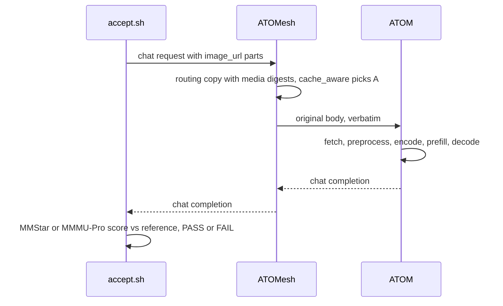
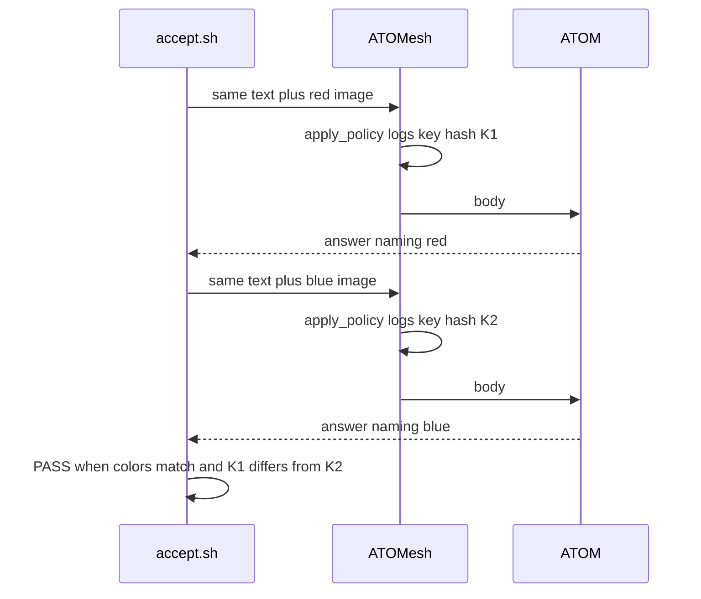
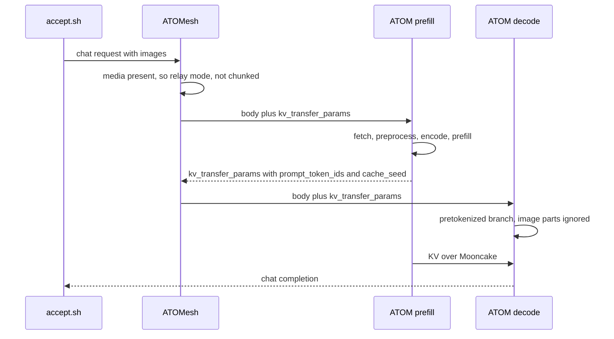
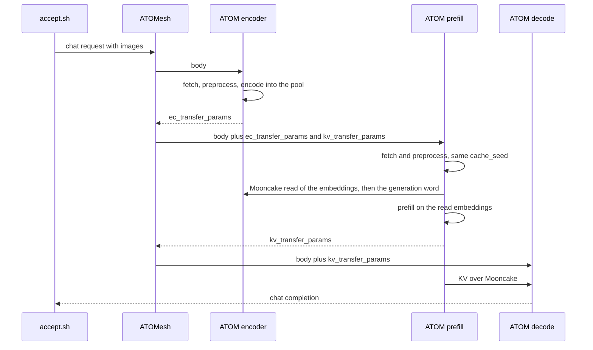
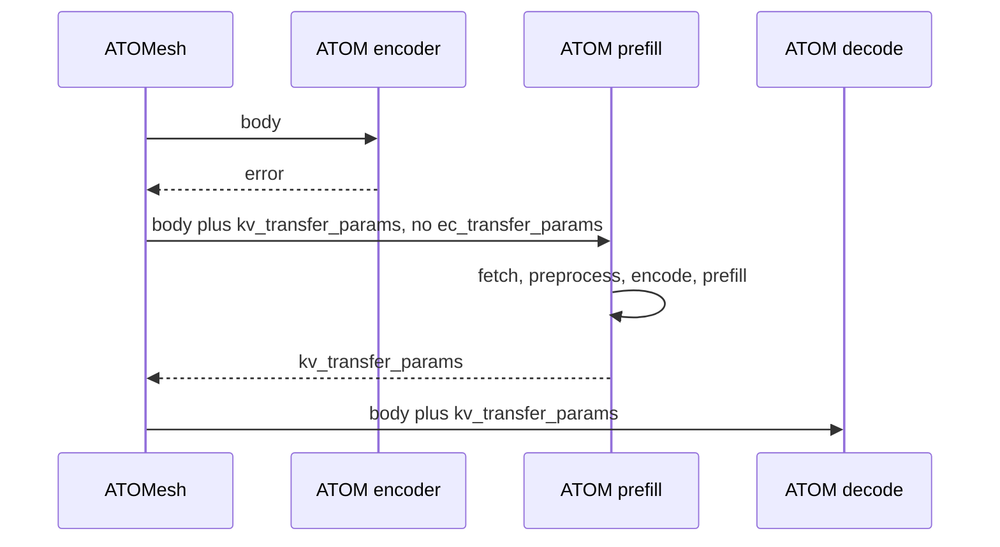
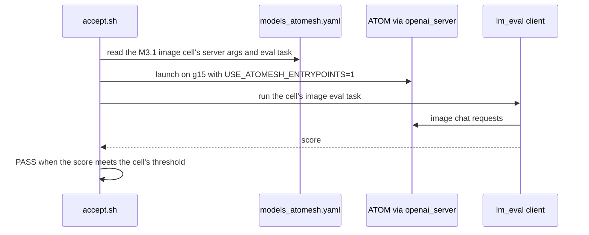

# ATOMesh multimodal image requests and E/P/D disaggregation

Design for junyyang-amd/ATOM#2: image chat requests through ATOMesh for
MiniMax-M3.1-Flash and Kimi-K3.1, as a single instance, as 1P1D, and as
E/P/D with an encoder-only ATOM instance. The requirement (goals,
acceptance A1 to A8, scope, non-goals) is the umbrella's; this document
says how to build it. Decisions are weighed against
[`agent_team_principles.md`](agent_team_principles.md).

Terms: **E** is the encoder-only ATOM instance, **P** the prefill
instance, **D** the decode instance. `cache_seed` is the engine's hash of
a request's processed pixels (`atom/model_engine/multimodal_runtime.py:
multimodal_cache_seed`). A **media digest** is ATOMesh's xxh3 of an image
URL string (`atom/mesh/src/routers/prepare/inference.rs:
with_media_digests`).

## Scenarios

### Single instance (A1, A2)

ATOMesh forwards the body unchanged; routing reads a copy that carries the
media digests. Nothing in the request path changes; A1 and A2 need the
harness only.



### Image distinction (A3, both models)

One text with a red and a blue image. The two requests share their text,
so only the media digests separate their routing keys; the router logs
one decision line per selection with a hash of its routing input.



On ATOM the prefix cache keeps the two apart through `cache_seed`, which
seeds the block hash chain (`atom/model_engine/block_manager.py`).

### 1P1D (A4)

P preprocesses and encodes; D receives the expanded prompt ids, the
`cache_seed` and the KV, and never touches the image.



### E/P/D (A5)

E fetches, preprocesses and encodes, and keeps the embeddings in a
Mooncake-registered GPU pool. P still fetches and preprocesses (for its
prompt ids, spans and `cache_seed`), then reads the embeddings from E
instead of running its tower. D is as in 1P1D.



`accept.sh m31 epd ttft` runs the same 4-image, 32-concurrent load against
this deployment and against A4's PD deployment, and prints both medians
and their delta.

### E/P/D when E cannot serve

No healthy encode worker, an E error, a failed read, a changed generation
word or a `cache_seed` mismatch all end in P encoding locally, as in PD.



### Kimi-K3.1 (A6, A7)

A6 runs MMStar directly against ATOM and records the score; it gates A7.
A7 walks the single, 1P1D and E/P/D diagrams above with `k31` and checks
each against A6's score. A failing A6 is an engine accuracy bug, escalated
and not fixed here (#2 Non-goals).

```
accept.sh k31 direct mmstar ──PASS + score──> reference
        │ FAIL: escalate, A7 not run
        v
accept.sh k31 single|pd|epd mmstar ──> within 2 x stderr of reference
accept.sh k31 epd ttft             ──> median TTFT <= K3.1 PD
```

### CI case (A8)



## Acceptance

| Item | Delivering modules | Check |
|---|---|---|
| A1 | as-is request path; harness | `bash tests/accept/atomesh_mm/accept.sh m31 single mmstar` |
| A2 | as-is request path; harness | `bash tests/accept/atomesh_mm/accept.sh m31 single mmmu-pro` |
| A3 | `policy_apply.rs` decision log; harness probe | `bash tests/accept/atomesh_mm/accept.sh <m31\|k31> single distinct` |
| A4 | `api_server.py` multimodal PD; `atom.rs` relay for media; harness | `bash tests/accept/atomesh_mm/accept.sh m31 pd mmstar` |
| A5 | encoder-only server; EC transport; `multimodal_runtime.py` callback; ATOMesh E role; harness | `bash tests/accept/atomesh_mm/accept.sh m31 epd mmstar && bash tests/accept/atomesh_mm/accept.sh m31 epd ttft` |
| A6 | harness | `bash tests/accept/atomesh_mm/accept.sh k31 direct mmstar` |
| A7 | as A1, A4, A5 | `bash tests/accept/atomesh_mm/accept.sh k31 <single\|pd\|epd> mmstar`, `bash tests/accept/atomesh_mm/accept.sh k31 epd ttft` |
| A8 | `models_atomesh.yaml` cell; `pd_matrix.py`, `pd_slurm_job.sh` image task; harness | `bash tests/accept/atomesh_mm/accept.sh m31 single ci-case` |

## Decisions

Code facts were checked at `fork/EPD` 3c5f13508.

### Request path and routing

**D1. The single-instance request path needs no change (A1, A2).** The
HTTP path forwards the body verbatim and routes on a copy carrying media
digests. Basis: code `atom/mesh/src/routers/ingress.rs:
InferenceEnvelope::parse_for_routing`, `prepare/inference.rs:
with_media_digests`. Rejected: route by `cache_seed`, which the router
cannot compute without running the image processor in Rust.

**D2. The routing key keeps the URL-string digest.** The same image under
two URL spellings routes as two images: a lower hit rate, never a wrong
answer, because the engine's prefix cache is seeded by the pixel hash.
Basis: code `multimodal_runtime.py: multimodal_cache_seed` hashes processed
pixels; principle: the simplest solution. Rejected: decode images in the
router and hash bytes, which adds image decoding to the Rust hot path for a
hit rate no acceptance item asks for.

**D3. Decision observability is one `debug` tracing event per selection.**
`apply_policy` logs pool, policy, selected worker, an xxh3 of the routing
input (text, else tokens, with media digests) and the media digest count;
the harness reads it at `RUST_LOG` debug for that module. Basis: code
`atom/mesh/src/core/placement/policy_apply.rs: apply_policy,
record_decision`; a metric label cannot carry the key, because
`atom/mesh/src/observability/metrics/schema.rs: intern_string` interns
every label string and never frees it, which its comment accepts only for
bounded label cardinality, so a per-request key would grow memory without
bound. Rejected: a response header carrying the key, a public interface
the requirement does not ask for.

### Multimodal PD

**D4. The shared multimodal generator carries `kv_transfer_params` on
the chat path.** `generate_async_multimodal` takes `kv_transfer_params`,
passes it on as `generate_async` does, and returns
`kv_transfer_output_meta_info` with the sequence's `cache_seed` added; the
chat multimodal branches (streaming, non-streaming, n>1) pass it.
`_prepare_engine_input` keeps its refusal of images with
`kv_transfer_params`: it serves only `/v1/messages` and `/v1/responses`,
whose images are a #2 non-goal, and their shared `_generate_nonstream`
does not hand `kv_transfer_params` to the multimodal generator, so without
the refusal a PD request there would stall D waiting for KV that P never
sends. Basis: code `atom/entrypoints/openai/api_server.py:
generate_async_multimodal` has no such parameter, `_prepare_engine_input`
raises "image input cannot be combined with kv_transfer_params" and is
called only by the messages and responses handlers; principle: fix shared code, not callers. Rejected:
fold the multimodal generator into `generate_async`, a larger change to the
text path project principle 2 keeps still.

**D5. Decode takes the pretokenized branch.** In `_chat_completions`, a
request whose `kv_transfer_params` carries `do_remote_prefill` and
`prompt_token_ids` takes the pretokenized branch before the `is_multimodal`
check; its image parts are ignored. Basis: code `_chat_completions` tests
`is_multimodal` first; `atom/mesh/src/core/placement/backend/atom.rs:
AtomAdapter::carry_prompt_token_ids` already sends P's expanded ids to D;
`atom/model_engine/scheduler.py` sends media to the runner for prefill
only. Rejected: ATOMesh strips image parts from D's body, which saves bytes
no item measures and leaves other routers hitting the engine's refetch.

**D6. D's prefix-cache identity comes from P.** D sets `Sequence.cache_seed`
from the `cache_seed` in `kv_transfer_params`. Basis: code
`atom/model_engine/sequence.py` derives `cache_seed` from media only, and
`block_manager.py` seeds the hash chain with it; without it D hashes the
expanded ids alone and two images with the same text could share KV (A3
runs with prefix caching on). Rejected: disable D's prefix cache for image
requests, a second code path with the cache off where A3 wants it on.

**D7. Requests with media take the relay path, never chunked mode.**
`AtomAdapter::can_chunk_request` returns false when the body has image
parts. Basis: code `atom.rs: AtomAdapter::can_chunk_request` checks only
`n`, `best_of` and the prompt; `atom/mesh/src/routers/http_pd_router.rs:
dispatch_atom_chunked_internal` starts D before P answers, so D would lack
the expanded ids and preprocess. Rejected: let D preprocess in chunked
mode, which #2's Scope forbids.

**D8. 1P1D for M3.1 runs on one g15 node.** P on GPUs 0-3 and D on 4-7 at
the recipe's TP4, Mooncake with `MC_DISABLE_HIP=1` and the HCAs named
as in D11, DSpark on as in the recipe. Basis: spike #5 (Dependencies)
measured text 1P1D correct this way, over TCP, and garbled without
`MC_DISABLE_HIP`; code `.github/benchmark/
models_atomesh.yaml` cell `minimax-m3-fp4-1p1d-tp4` sets it; project
principle 5. Rejected: two nodes, which need an owner-named node for a
topology shown correct on one.

### E/P/D in the engine

**D9. E encodes, P still preprocesses.** E fetches, preprocesses and
encodes, keeping the embeddings under the media's `cache_seed`. P still
fetches and preprocesses to get the expanded ids, spans and the same
`cache_seed`; its encode callback in `VisionEmbeddingCache.acquire` reads
E's embeddings instead of running the tower. D is as in PD. Basis:
reference: vLLM's disaggregated encoder keys encoder output by media hash
and the prefill instance loads it while processing the prompt
(<https://docs.vllm.ai/en/latest/features/disagg_encoder/>); code
`atom/model_engine/multimodal_runtime.py: VisionEmbeddingCache.acquire` is
P's one point that obtains embeddings. Rejected: E returns ids, spans and
embeddings and P takes them pretokenized, which saves P's CPU
preprocessing but adds a second request shape to P and moves template
rendering to E.

**D10. E is `openai_server --encoder-only`, without an engine core.** A
`Config` field and CLI flag, as `enable_rapidserve` is declared
(`atom/config.py`, `atom/model_engine/arg_utils.py`). The server builds
only the model's vision modules on one GPU (`build_vision_modules` in
`atom/models/minimax_m3/vl.py` and `atom/models/kimi_k3_vl.py`), loads
their weights through `atom/model_loader/loading_core.py:
load_weights_into_model` with the language-model prefixes skipped, and
encodes one request at a time on one thread fed by a queue. The chat
handler preprocesses with the existing `_prepare_multimodal_inputs`. Basis:
code: both towers are replicated on every TP rank (their module
docstrings), so E at TP1 runs the tower P runs; `embed_multimodal_batch`
encodes request by request, so P does not batch encodes across requests
either; principle: the simplest solution, reuse existing code. Rejected: a
vision-only mode of `ModelRunner` behind the engine core, which needs an
encoder-only branch in KV sizing (`allocate_kv_cache`), `warmup_model`,
`capture_cudagraph` and the scheduler's `Sequence` model, all on the text
hot path, to buy batching P does not use. Low confidence: see below.

**D11. Embeddings move over Mooncake; P pulls.** E registers its pool with
a Mooncake TransferEngine; each P rank reads with `transfer_sync_read`
inside the encode callback. Device selection reuses the KV connector's
`mooncake_connector.py: _select_ib_devices`, with `MC_DISABLE_HIP=1` as for
KV, and the harness names the HCAs: it sets `ATOM_MOONCAKE_IB_DEVICE` on E,
P and D to the `rocep*` HCAs local to each role's GPUs, as spike #7 passed
them (`bench.py --ib`). `_select_ib_devices` takes a configured device
before `_auto_select_ib_device`, which on g15 picks a missing `rdma<N>`
and leaves Mooncake on TCP (#12). The variable holds one value per server,
not per rank: E, on one GPU, registers on its local HCA, but each TP4 rank
of P and D registers on every HCA listed for its role, and the connector
advertises `ib_device` as None for a multi-HCA engine
(`mooncake_connector.py: MooncakeConnector.__init__`). A4's run shows
whether KV still moves over RDMA that way, by the HCA counters #7 read;
per-rank selection is #12's fix. Naming them also moves A4's and A5's KV
onto the same transport, so A5's PD baseline runs on it too, and A4's
`mmstar` check covers KV over RDMA, which spike #5 did not run. Basis:
spike #7 measured Mooncake RDMA at 0.56 ms for 16 MiB against 15.5 ms for
an HTTP pull and 118 ms inline through ATOMesh, on one node; spike #6
measured a median 11 MB per A5 request and 8.5 ms of encode per image
inside a 4-image request; code `embed_multimodal_batch` runs the callback
inside the forward step, so a fetch blocks every request in the batch on
every rank; principle: reuse existing dependencies. Rejected: HTTP pull
from E's host memory, about 200 lines less (#9's estimates). It would
likely meet A5 as well: about 11 ms per median request against an upper
bound of 300 to 480 ms saved. But that 11 ms sits in P's forward step,
where it gives back a third of the 34 ms of encode E removes from it, and
it accumulates across queued steps as the encode share does; how much of
the upper bound survives E's hop, fetch, preprocess and encode is
unmeasured until A5's `ttft` check runs. Mooncake keeps that third for the
200 lines. Low confidence: see below.

**D12. E keeps an entry for a lease, guarded by a generation word.** E's
pool reuses space oldest-first, and only once an entry is older than
`ATOM_EC_LEASE_S` (defined in `atom/utils/envs.py`, project principle 3).
Each entry starts with a generation word E bumps on reuse. P reads the
payload, then rereads the word; a changed word, a failed read or a
`cache_seed` other than its own makes P run its own tower, which it keeps
loaded. Basis: code `MiniMaxM3SparseForConditionalGenerationVL.__init__`
builds the tower wherever image input is accepted, so the fallback is the
existing encode lambda; principle: the simplest solution. Rejected: P's
ranks release each entry after reading, an exact lifetime that needs a
channel from `ModelRunner` subprocesses to E and E knowing P's TP size.

**D13. E answers with `ec_transfer_params`, as P answers with
`kv_transfer_params`.** E returns a chat completion with no choices and an
`ec_transfer_params` object (Mooncake session, `cache_seed`, address,
length, generation, rows). ATOMesh copies it into P's body; P's chat path
puts it into the request's `multimodal_data`, which the scheduler already
carries to the runner for prefill. A body without it behaves as today.
This conflicts with the principle "Change public interfaces only when the
requirement does": the chat request and response gain an optional
`ec_transfer_params`, and E's response has no choices. The requirement
settles it: #2's Goal 3 has E hand embeddings to P with ATOMesh
orchestrating E to P to D, so the handoff must cross the HTTP interface
between them. It follows the precedent of `kv_transfer_params`, the
optional field the chat request and response already carry for the P to D
handoff. A client of a single or PD deployment sees neither field nor a
choice-less response: only an `--encoder-only` server answers that way,
and only ATOMesh calls it. Basis: code `atom/entrypoints/openai/
protocol.py: ChatCompletionResponse` (`kv_transfer_params`), `api_server.py:
_with_kv_transfer_params`, `atom.rs: AtomAdapter::enrich_decode_kv`,
`multimodal_runtime.py: prefill_media_payload` (keeps every key but
`token_types` and, once leased, the pixels); principle: follow existing
conventions. Rejected: a new `/v1/encode` endpoint with its own schema,
which changes the public interface more than an optional field on the
existing one.

**D14. E/P/D can meet A5 on the measured margin.** At A5's workload the
tower is 44-51% of P's prefill forward time and a median 32-36% of TTFT
(spike #6); E removes it from P's forward step for under 1 ms of transfer
on one node (spike #7; the cross-node read is under Low confidence) plus
E's hop. The request's own encode moves to E rather than
vanishing; the gain is P's shorter step, which every queued request waits
on. Basis: spikes #6 and #7. Rejected: hold the E role until a prototype
measures A5, when the margin is an order of magnitude above the added
transfer and A5's `ttft` check measures the built system.

### ATOMesh E role

**D15. `WorkerType::Encode`, `--encode <url>` and `--encode-policy`, in PD
mode.** Declared and registered like prefill and decode workers; for a
chat request with media and at least one healthy encode worker,
`dispatch_pd` first posts the body to E, then runs the existing P to D
relay with `ec_transfer_params` added to P's body. Text requests and
deployments without `--encode` take today's path, and
`IngressRouting::candidates`, which admits every non-`Regular` worker in PD
mode, excludes encode workers. Basis: code `atom/mesh/src/core/worker.rs:
WorkerType`, `cliargs.rs: parse_prefill_args_from`,
`core/steps/worker/local/create_worker.rs: parse_worker_type`,
`config/types.rs: RoutingMode::PrefillDecode`, `http_pd_router.rs:
dispatch_pd`, `routers/ingress.rs: IngressRouting::candidates`; project
principle 2; principle: prefer reversible choices. Rejected: a separate
E/P/D router, which duplicates `dispatch_pd`'s retry, reservation and load
guards.

**D16. E failure falls back to PD.** With no healthy encode worker or an E
error, ATOMesh sends the request to P without `ec_transfer_params`, and P
encodes. Basis: D12 keeps P's tower; principle: prefer reversible choices.
Rejected: fail the request, which turns an E outage into client errors
although P can serve it.

### Topology, models, CI and harness

**D17. E for M3.1 runs on one GPU of a second, owner-named node.** P and D
take all of g15; PD for A5's comparison runs on g15 as in A4. The node must
reach g15's `rocep*` HCAs over RoCE, so D11's read stays on RDMA; the
harness confirms it from E's HCA counters, as spike #7 did, and fails the
run otherwise. Basis: #2's Acceptance allows owner-named nodes for
multi-node runs; project principle 5; D11. Rejected: E on a D GPU with D's
memory utilization lowered, which departs from the recipe and muddies A5's
comparison. Low confidence: see below.

**D18. K3.1 uses the same code at the recipe's TP8.** Its input builder
already emits spans and `cache_seed`. A6 runs first and gates A7. 1P1D
needs two nodes and E/P/D a third GPU, all owner-named. Basis: code
`atom/models/kimi_k3/image_processing.py: build_kimi_k3_inputs`;
`recipes/Kimi-K3.1.md` ("TP4 cannot hold the resident checkpoint; use
TP8"). Rejected: a smaller TP to fit one node, which the recipe rules out.

**D19. The CI case is a `topology: agg` M3.1 cell in
`models_atomesh.yaml`.** It carries an image eval task;
`accept.sh m31 single ci-case` runs that cell's server arguments the way
`atomesh-accuracy-validation.yaml` runs a model
(`USE_ATOMESH_ENTRYPOINTS=1 openai_server`, an lm_eval client) on g15.
`pd_matrix.py` and `pd_slurm_job.sh` accept the image task, so the cell
stays valid for `atomesh-benchmark.yaml`, which reads the file. Basis: code
`.github/workflows/atomesh-accuracy-validation.yaml` reads
`models_accuracy.json`, not `models_atomesh.yaml`;
`.github/scripts/atomesh/pd_matrix.py` allows only `gsm8k` and
`swebench_lite`. Rejected: put the case in `models_accuracy.json`, which
contradicts Goal 5's named file. Low confidence: see below.

**D20. The harness is `tests/accept/atomesh_mm/accept.sh <model>
<topology> <check>`.** It launches containers on the nodes over ssh per the
recipe, runs MMStar, MMMU-Pro, the red/blue probe or the TTFT load through
ATOMesh, prints one JSON line and `PASS` or `FAIL <reason>`. No file is
named `test_*.py`, so pytest does not collect it. Basis: #2 fixes the path
and output; project principle 1 keeps GPU runs out of the gate. Rejected:
a pytest GPU suite, which the CPU-only gate cannot run.

## Simpler alternative

The simplest E/P/D: E returns the embeddings base64-encoded in its
response, ATOMesh copies them into P's body, and P decodes them in its API
server. No Mooncake pool, lease or generation word: about 100 lines of
transport against about 300 (#9's estimates).

It puts A5 at risk. Spike #7 measured inline transfer at a median 31 ms for
4 MiB and 118 ms for 16 MiB, one transfer at a time, mostly Python base64
and JSON; A5's median request carries 11 MB and its largest 22 MB, so
inline adds roughly 80 to 170 ms to each image request's critical path
before any contention from 32 concurrent requests on ATOMesh and on P's
API server, which also preprocesses images. The saving it must fit inside
is an upper bound of 32-36% of a median TTFT of 921-1333 ms (spike #6),
from which E's own hop and encode already come.

## Low confidence

- **D10, E encodes on a server thread.** The encode thread shares the
  server's GIL with HTTP handling and preprocessing; whether that limits E
  at 32 concurrent shows only on a built E, which A5's `ttft` check is.
  The rejected `ModelRunner` mode costs a branch on the text hot path in
  several places; the chosen design keeps its fallback (the encode loop in
  one spawned process behind the same queue) inside the encoder module.
- **D11, the cross-node read.** Spike #7 measured Mooncake on one node
  only; E sits on a second node (D17), so the read P makes in its forward
  step is unmeasured across nodes. No cross-node figure picks the HTTP pull
  while the read stays on RDMA, which D17 requires of E's node. The pull's
  single-node cost (11 ms for a median request) is Python HTTP and host
  copies over loopback; across nodes it pays the same plus a real network
  hop, so it does not fall. Mooncake's read across nodes is bound by g15's
  400 Gb/s HCA ports (`/sys/class/infiniband/*/ports/1/rate`): about 0.25
  ms of wire time for 11 MB. To match the pull it would have to slow about
  28-fold, from 0.56 to 15.5 ms at 16 MiB, which only a fall back to TCP
  does. That leaves the read's own cost to A5's `ttft` check, and nothing
  to #7's cross-node cell that would change D11.
- **D17, E's node.** It rests on the owner naming a second node that
  reaches g15 over RoCE; no data settles it. K3.1 (D18) needs owner-named
  nodes too.
- **D19, the CI case.** It reads two files #2 names together
  (`models_atomesh.yaml` holds the case, `atomesh-accuracy-validation.yaml`
  defines how it runs); no data settles a reading. If the owner reads A8
  otherwise, only the CI cell and its `ci-case` check change.

## Dependencies

| Spike | Result | PR, head |
|---|---|---|
| #5 | M3.1 text 1P1D on one g15 node is correct with `MC_DISABLE_HIP=1`, DSpark on and off; garbled without it | #13 (closed), 3555a800009f7c62b12f88b5481183d95aa97414 |
| #6 | At 4 images x 32 concurrent the tower is 32-36% of median TTFT and 44-51% of prefill forward time; median 11 MB (max 22 MB) of embeddings per request | #10 (closed), 6b51e69ddedb618002563a59ab0fe37f02344cc0 |
| #7 | E to P on one node: Mooncake RDMA 2.1 ms at 64 MiB, HTTP pull 82 ms, inline through ATOMesh 552 ms | #9 (closed), e255a71d76120e38f2c88d304c4aaee873719e47 |

No interface here exists only upstream, so no sync issue is needed.

Open backlog issues near the runs: #12 (Mooncake auto-selects a missing
HCA on g15 and falls back to TCP) stays in the backlog, because the
harness names the HCAs (D11); it is also the per-rank fix should A4's run
show a multi-HCA engine off RDMA. #11 is a flaky upstream tree test the
local gate skips.

## Summary

**Deliverable**: multimodal image requests through ATOMesh for M3.1 and
K3.1 in single, 1P1D and E/P/D topologies, the acceptance harness and one
CI case, as #2 states.

**Non-goals**: as #2. Also no images over gRPC, no PD for images on
`/v1/messages` and `/v1/responses` (the refusal in `_prepare_engine_input`
stays), and no embedding cache beyond E's lease.

**Changes per file**

- `atom/entrypoints/openai/api_server.py`: `kv_transfer_params` through
  `generate_async_multimodal` and its callers, `cache_seed` in its kv
  output (D4); the pretokenized branch first for remote-prefill decode, and
  `cache_seed` onto the sequence (D5, D6); `ec_transfer_params` into
  `multimodal_data` (D13); the encoder-only startup and chat answer (D10,
  D13).
- `atom/entrypoints/openai/protocol.py`: `ec_transfer_params` on the chat
  request and response (D13).
- `atom/model_engine/sequence.py`: `cache_seed` taken from
  `kv_transfer_params` on a pretokenized remote-prefill request (D6).
- `atom/config.py`, `atom/model_engine/arg_utils.py`: `encoder_only` (D10).
- `atom/utils/envs.py`: `ATOM_EC_LEASE_S` (D12).
- New encoder module (vision-only model build, weight load, encode queue)
  and new EC transport module (E's registered pool and lease, P's read and
  generation check) beside the Mooncake KV connector (D10 to D12).
- `atom/model_engine/multimodal_runtime.py`: the encode callback reads
  from E when `ec_transfer_params` is present, else runs the tower (D9,
  D12).
- `atom/mesh/src/core/placement/policy_apply.rs`: the decision event (D3).
- `atom/mesh/src/core/placement/backend/atom.rs`: `can_chunk_request`
  false for bodies with image parts (D7).
- `atom/mesh/src/core/worker.rs`, `cliargs.rs`, `config/types.rs`,
  `core/steps/worker/local/create_worker.rs`, `routers/ingress.rs`,
  `routers/http_pd_router.rs`: the E role, its dispatch and fallback (D15,
  D16).
- `tests/accept/atomesh_mm/`: `accept.sh` and its helpers, with g15's
  GPU-to-HCA map for `ATOM_MOONCAKE_IB_DEVICE` (D11, D20).
- `.github/benchmark/models_atomesh.yaml`, `.github/scripts/atomesh/
  pd_matrix.py`, `.github/scripts/atomesh/pd_slurm_job.sh`: the CI cell
  and the image eval task (D19).
- CPU tests under `tests/` and Rust tests in `atom/mesh` for each of the
  above (project principle 1).

**Acceptance**: A1 to A8 as #2 states, each checked by the command in the
Acceptance table. Runs need owner-named nodes for M3.1 E (D17) and for
K3.1 at TP8 (D18).
