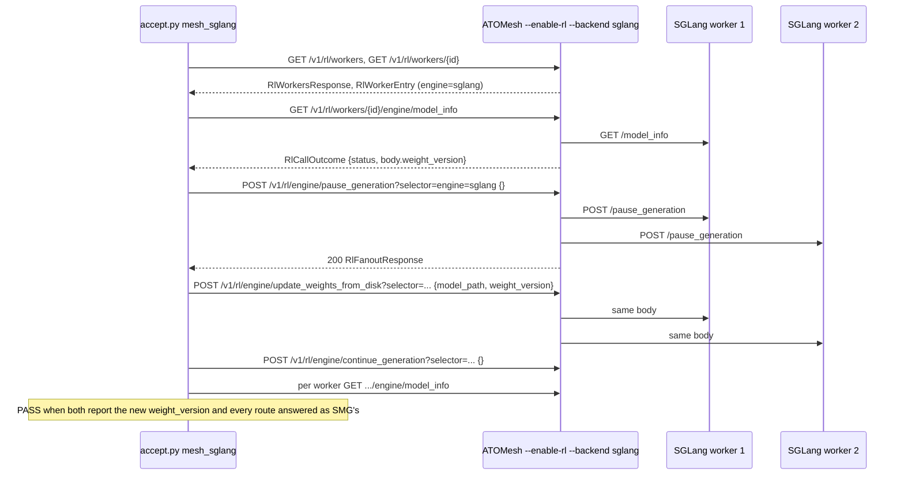
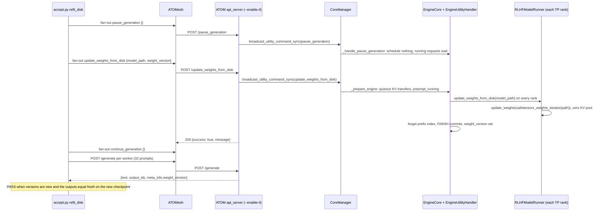
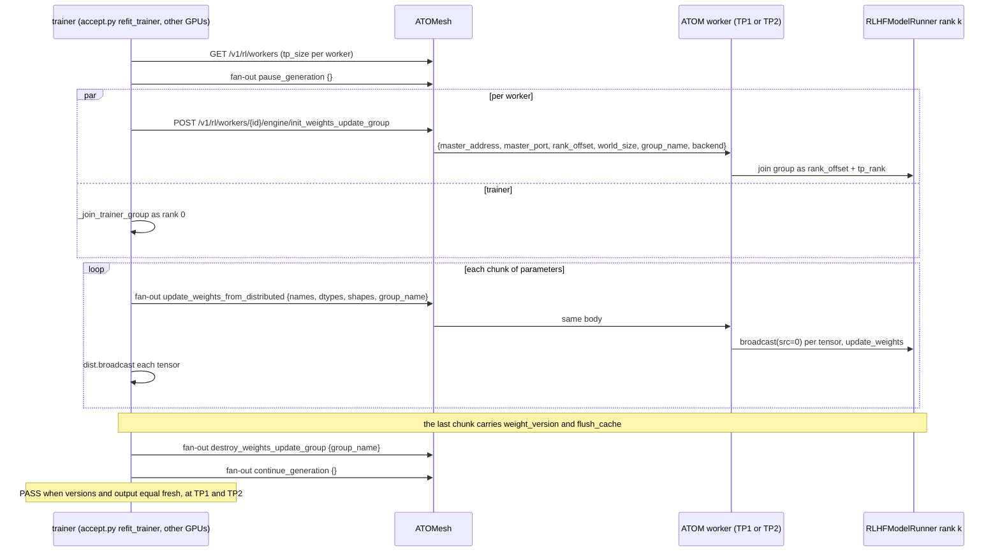
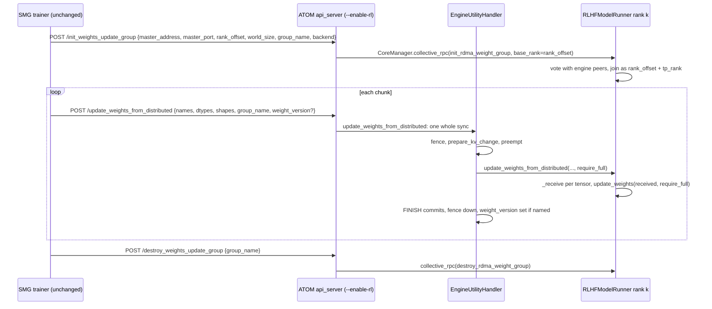
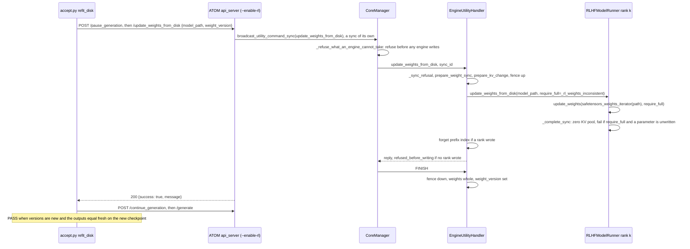

# ATOMesh RL rollout control plane

A training process pauses, refits and resumes a group of rollout workers
through ATOMesh's `/v1/rl/*` routes, which speak SMG's RL protocol
(smg-project/smg@6c7bda118c5c6c02e65fe104cc8d93a0f906c965, `crates/rl` and
`examples/rl`; "SMG" below means that commit). ATOM workers serve the engine
routes behind it. The requirement, its goals and its acceptance items A1 to
A9 are the umbrella issue's
([#76](https://github.com/junyyang-amd/ATOM/issues/76)); this document says
how to build them. Principles cited here are in
[`agent_team_principles.md`](agent_team_principles.md).

Code is cited as `path: symbol` at `fork/RL` 2f9d30a7. ATOMesh paths are
relative to `atom/mesh/`; SMG paths to the SMG checkout.

## Scenarios

Every RL control call goes client -> ATOMesh -> engine; the client never
connects to a worker (goal 1). ATOMesh is launched with the long-rollout
profile in every scenario (Decision D12).

### A1: mesh routes on SGLang



The check also probes SMG's error answers: `selector_required`,
`invalid_selector`, `no_workers_match`, `worker_not_found`,
`invalid_engine_path`.

### A2: refit from disk on ATOM (goals 2, 3, 5)



### A3: refit from a trainer over RCCL (goal 5)



### A4: selector (goal 1)

```text
accept.py selector
  pause / update_weights_from_disk / continue with selector=url=<worker 1 url>
    -> ATOMesh rl::fanout resolves targets: worker 1 only
  worker 1: new weight_version, output equals fresh on the new checkpoint
  worker 2: old weight_version, output equals fresh on the old checkpoint   -> PASS
  (selector matching nothing -> 400 no_workers_match, nothing sent)
```

### A5: cache (goal 3)

```text
accept.py cache
  /generate P1 = shared prefix + tail A        -> fills the prefix cache
  /generate P1 again                           -> meta_info.cached_tokens > 0 (the probe works)
  pause -> update_weights_from_disk -> continue
     EngineUtilityHandler: kv_change = "weights"
       -> runner zeroes the KV pool, _forget_cached_prefixes drops the index
  /generate P1                                 -> cached_tokens == 0, output equals fresh  -> PASS
```

### A6: refit time

```text
accept.py refit_disk / refit_trainer  record pause-sent -> continue-answered wall time
accept.py timing  reads both JSON files      -> PASS when each holds a time
```

### A7: stability (goal 6)

```text
ATOMesh: --enable-rl --rl-api-key <key> --disable-health-check --disable-circuit-breaker --request-timeout-secs 14400
repeat 20 rounds:
  pause -> update_weights_from_disk (alternate checkpoints) -> continue
  64 concurrent /generate rollouts
  GET /v1/rl/workers: same ids and urls as round 1
PASS when 0 requests failed and the worker list never changed
```

### A8: SMG client compatibility (goal 4)

```text
PYTHONPATH=<smg>/bindings/python/src python <smg>/examples/rl/refit_from_disk.py \
    --smg <ATOMesh url> --model-path <ckpt> --weight-version <v> --selector engine=atom
  RL.workers()                  -> /v1/rl/workers, ATOM rows report engine=atom
  paused(): pause_generation {} -> ATOM default mode "keep"
  fanout update_weights_from_disk {model_path, weight_version, flush_cache}
  continue_generation {}
  POST <ATOMesh>/generate {"text":"1+1=","sampling_params":{"max_new_tokens":4}}
    -> ATOMesh HTTP router -> ATOM /generate -> meta_info.weight_version == <v>
exit 0 -> PASS smg_client
```

The script runs unmodified from a checkout of SMG at the pinned commit; the
check refuses another commit. It passes `--selector engine=atom` in place of
the script's default `engine=sglang`, as the
[Ruling on #77](https://github.com/junyyang-amd/ATOM/issues/77#issuecomment-6943320782)
and #76 A8 fix.

### A9: 1P1D (goal 7)

```mermaid
sequenceDiagram
    participant H as accept.py pd
    participant M as ATOMesh (PD, backend atom)
    participant P as ATOM prefill
    participant D as ATOM decode
    H->>M: 64 concurrent completions (in flight)
    H->>M: fan-out pause_generation {} ?selector=engine=atom (P and D)
    M->>P: pause
    M->>D: pause
    H->>M: fan-out update_weights_from_disk {model_path, weight_version: v2} ?selector=engine=atom
    M->>P: update: paused, v2 is new; preempt prefills, does not wait on PD sends
    M->>D: update: paused, v2 is new; preempt running, parked requests stay parked
    H->>M: fan-out continue_generation {} ?selector=engine=atom
    P-->>D: handoffs stamped v1 (before refit) or v2 (after)
    D->>D: stamp == own version: first decode; else free blocks, prefill on D
    Note over H: in flight: 64 completed, 0 failed
    H->>M: 32 prompts, one at a time
    Note over H: PASS when P and D report v2 and output equals a fresh 1P1D on v2
```

## Decisions

Each decision names its basis and its strongest rejected alternative.

### D1. Where the control plane lives

A new module `src/rl/` in the `atomesh` crate, mounted from
`server.rs: build_app` only when `--enable-rl` is set: `selector`,
`discovery`, `proxy`, `fanout`, `error`, each porting SMG's
`crates/rl/src` logic of the same name as ATOMesh code over its
`WorkerRegistry`. With RL off no route is added.

- Basis: code: `Cargo.toml` is one package (`atomesh`) with no workspace;
  `server.rs: build_app` merges route groups. reference: SMG
  `crates/rl/src/lib.rs: router`. principle: SMG's protocol is the spec;
  with RL off, nothing changes.
- Rejected: depend on SMG's `smg-rl` crate. The overlay forbids vendoring
  SMG, and the crate is written against `RlWorkerView` over SMG's registry.

### D2. The control fan-out is its own, not `fan_out`

`rl::fanout` sends the caller's body verbatim, with a per-call timeout
`--rl-control-timeout-secs` (default 600), at most `--rl-fanout-concurrency`
calls at once (default 32), to each target's base URL (a DP group is called
once, on its lowest rank), with no retry, breaker or load accounting.

- Basis: code: `core/worker_manager.rs: fan_out` sends no body, uses the
  fixed 5 s `REQUEST_TIMEOUT` and `worker.url()`, which carries `@rank` for
  DP workers. reference: SMG `crates/rl/COUPLING.md` (why the proxy is
  separate), `crates/rl/src/fanout.rs: run_fanout`.
- Rejected: extend `fan_out` with a body and timeout. Its caller
  `WorkerManager::flush_cache_all` wants the opposite policy, and one
  mechanism would carry flags for two.

### D3. A worker's `engine` and capabilities

`engine` is `RouterConfig.backend` (`sglang`, `vllm`, `atom`) for an HTTP
worker. ATOM workers report a static capability row: `pause_modes: [keep]`,
`update_from: [disk, distributed]`, `abort: false`, `flush_cache: true`,
`sleep_wake: false`, `reports_weight_version: true`; SGLang and vLLM rows are
SMG's. `rl.*` labels override the row as in SMG, except that a flag label
parses leniently (SMG-vs-ATOMesh differences table below).

- Basis: code: `core/worker.rs: WorkerMetadata.runtime_type` is gRPC-only
  and `create_worker.rs: determine_runtime_type` sets `Sglang` for every
  HTTP worker; `config/types.rs: BackendType` has `Atom`. reference: SMG
  `discovery.rs: engine_name`, `capability.rs: static_for`. Ruling on #77:
  ATOM workers report `engine: atom`.
- Rejected: report ATOM as `sglang`. Ruled out on #77; its row would claim
  `abort` and `retract` pause modes ATOM lacks.

### D4. ATOM engine routes

`atom/entrypoints/openai/api_server.py` registers the routes below with
`_engine_route` only when the server runs with `--enable-rl`
(`atom/model_engine/arg_utils.py: EngineArgs`). Each POST is one
`CoreManager.broadcast_utility_command_sync` to a handler in
`EngineUtilityHandler._UTILITY_HANDLERS` and answers SGLang's
`{"success", "message"}` with 200, or 400 on failure.

| Route | Body (SGLang field names) | Utility command |
|---|---|---|
| POST `/pause_generation` | `{mode?}`; only `keep` (default) accepted | `pause_generation` |
| POST `/continue_generation` | `{}` | `resume_generation` |
| POST `/update_weights_from_disk` | `model_path`, `weight_version?`, `flush_cache?` | `update_weights_from_disk` |
| POST `/init_weights_update_group` | `master_address`, `master_port`, `rank_offset`, `world_size`, `group_name`, `backend` | `init_weights_update_group` |
| POST `/update_weights_from_distributed` | `names`, `dtypes`, `shapes`, `group_name`, `flush_cache?`, `weight_version?` | `update_weights_from_distributed` |
| POST `/destroy_weights_update_group` | `group_name` | `destroy_weights_update_group` |
| POST `/flush_cache` | none | `clear_kv_cache` |
| GET `/model_info` | none | `get_weight_version`; answers `model_path`, `weight_version` (D8) |
| POST `/generate` | see D9 | the completion path |

- Basis: code: `api_server.py: _engine_route` relays management routes to
  the engine-owning process; `engine_utility.py: EngineUtilityHandler`
  already fences, preempts and forgets prefixes around weight updates.
  reference: SGLang `io_struct.py` (`UpdateWeightFromDiskReqInput`,
  `InitWeightsUpdateGroupReqInput`, `UpdateWeightsFromDistributedReqInput`,
  `DestroyWeightsUpdateGroupReqInput`); SMG `crates/rl/NOTES.md` reads the
  version from `/model_info`, not `/get_weight_version`.
- Rejected: serve `atom/rollout/async_engine.py: AsyncLLMEngine` behind
  HTTP. It wraps the same utility commands for verl and adds nothing the
  handlers lack.

On `main`'s weight sync the two group routes run `init_rdma_weight_group` /
`destroy_rdma_weight_group` through `CoreManager.collective_rpc` instead
(M3).

### D5. The served runner

`--enable-rl` sets `runner_qualname` to
`atom.rollout.model_runner_ext.RLHFModelRunner`, as `AsyncLLMEngine.__init__`
does, unless the user set another.

- Basis: code: `atom/config.py: Config.runner_qualname` defaults to the base
  `ModelRunner`, which has no `update_weights`; `async_engine.py:
  AsyncLLMEngine.__init__`. principle: reuse existing code first
  (agent-team defaults).
- Rejected: move `WeightUpdaterMixin` into `ModelRunner`. Every served
  engine would carry it, RL or not.

### D6. Loading from disk

`RLHFModelRunner.update_weights_from_disk(model_path)` on every TP rank calls
`update_weights` once, passing
`atom/model_loader/weight_iterator.py: safetensors_weights_iterator(model_path)`
as a generator, so one tensor is resident at a time. `update_weights_from_disk`
joins `engine_utility.py: WEIGHT_UPDATE_UTILITY_CMDS`, so `kv_change` returns
`"weights"`: the update is fenced, preempts, zeroes the pool, forgets cached
prefixes and is committed by FINISH like an SHM update.

- Basis: code: `weight_updater.py: WeightUpdaterMixin.update_weights`
  iterates its argument once and handles packed `qkv` / `gate_up` through
  `weight_loader`; `model_loader/loader.py: load_model` runs
  `process_weights_after_loading` on every module, which a built model must
  not run twice.
- Rejected: call `load_model` again. Post-processing would run on already
  processed weights.

On `main`'s weight sync the call also passes `require_full`, and the whole
checkpoint is resident per rank while it writes (M7).

### D7. The trainer group

`init_weights_update_group` runs `RLHFModelRunner.init_weights_update_group`
on every TP rank: it joins a NCCL group through torch's
`_new_process_group_helper` over `PrefixStore(group_name, TCPStore)` as rank
`rank_offset + tp_rank`, the layout SMG's trainer forms
(`examples/rl/refit_from_trainer.py: _join_trainer_group`, `rank_layout`).
`update_weights_from_distributed` receives each tensor by `broadcast(src=0)`
and yields it into one `update_weights` call; `destroy_weights_update_group`
destroys the group. Group init and destroy run through
`EngineUtilityHandler._utility_on_every_rank`; the update joins
`WEIGHT_UPDATE_UTILITY_CMDS` (D6).

- Basis: data: [spike #91](https://github.com/junyyang-amd/ATOM/issues/91) (PR #93 at 2db68bb3): at TP2 on
  Qwen3-8B the group formed beside ATOM's TP group, took every parameter,
  was destroyed and re-formed in every round, and the engine matched fresh.
  code: `collective_rpc.py: COLLECTIVE_RPC_METHODS` gates public
  `collective_rpc`.
- Rejected: add these methods to `COLLECTIVE_RPC_METHODS`. The update
  would bypass the weight-sync fence and `kv_change`: no preemption, no
  prefix flush.

SMG's trainer sends one `update_weights_from_distributed` per chunk of
parameters, so each chunk is one `update_weights` call, which clears
`_packed_weight_accum` at its end. A chunk boundary inside a packed FP8
`qkv` loses shards (spike #91 handoff). The acceptance models are bf16 and
never take that path; FP8 checkpoints are a non-goal here, and the defect
is [#97](https://github.com/junyyang-amd/ATOM/issues/97).

On `main`'s weight sync the group and the write are rebuilt as M3 to M6
say.

### D8. `weight_version`

The scheduler, in the EngineCore process, holds the engine's version
string: `--weight-version` (default `"default"`), replaced when a committed
update names one. The API server reads it two ways:

- `/model_info` is an `_engine_route`, so with `--api-server-count` above 1
  a front-end worker relays it to the hub. The hub sends the utility command
  `get_weight_version` through `CoreManager.broadcast_utility_command_sync`
  and answers DP rank 0's reply; every DP engine commits an update in the
  same FINISH, so their versions agree once it returns.
- `/generate` reads it from the request's own output: the scheduler sets a
  new field `RequestOutput.weight_version` on every output it builds
  (`Scheduler.postprocess`), and the response reports the one on the final
  output. `RequestOutput` is pickled whole from EngineCore to the hub and
  from the hub to a front-end worker (`frontend_workers.py: FrontendHub`),
  so the field reaches every API process with no relay.

A request in flight across a refit reports the version its last token was
sampled under: the new one, since the refit preempts it and it finishes
after the commit. `/v1/rl/workers[].weight_version`
stays the registration label, as in SMG.

- Basis: reference: SMG `discovery.rs: entry` reads
  `labels["weight_version"]`; its examples verify through `/generate` and
  `/model_info`. code: ATOMesh's own `/generate` rendering reports
  `"default"` when a worker gives no version
  (`routers/render/generate_streaming.rs`); `api_server.py: _engine_route`
  sends a management route to the engine-owning process;
  `engine_core_mgr.py: CoreManager.broadcast_utility_command_sync` returns
  every DP engine's reply.
- Rejected: the hub caches the version from the committed update's reply.
  A second copy of state the engine owns, right only while every update
  passes through the hub's routes.
- Rejected: ATOMesh rewrites the label after a refit. A difference from SMG
  no acceptance item needs.

### D9. `/generate` on ATOM

An SGLang-shaped `/generate` behind `--enable-rl`: `text` or `input_ids`,
`sampling_params` (`max_new_tokens`, `temperature`, `top_p`, `top_k`,
`stop`, `ignore_eos`), non-streaming; answers `text`, `output_ids` and
`meta_info{id, finish_reason, prompt_tokens, completion_tokens,
cached_tokens, weight_version}`. It runs the completion path;
`cached_tokens` is the request output's `num_cached_tokens`.

- Basis: code: ATOMesh routes `/generate` (`routers/ingress.rs:
  EndpointSpec::ALL`) through `http_router.rs: route_inference` to the
  worker; ATOM has no `/generate`; `api_server.py: generate_async` already
  carries `num_cached_tokens`. reference: SMG `refit_from_disk.py` posts
  `/generate` and reads `meta_info.weight_version`.
- Rejected: the harness uses `/v1/completions` only. A8's unmodified script
  posts `/generate`.

### D10. Pause, single instance

ATOM keeps its `keep` mode: running requests wait; the update preempts them
(`Scheduler.preempt_running`) and after resume they recompute prompt and
generated tokens on the new weights, keeping their tokens; none fails.

- Basis: code: `engine_utility.py: _handle_pause_generation`,
  `engine_core.py: EngineCore.prepare_kv_change`,
  `scheduler.py: Scheduler.preempt`.
- Rejected: SGLang's default `abort`. It fails requests; A7 and A9 require 0
  failed.

### D11. PD in-flight policy

The policy: no request fails, and no KV computed with other weights is
decoded on. Requests waiting on P are prefilled after the resume on P's new
weights. Every handoff P produces carries P's `weight_version`; D lets each
transfer finish as today, then decodes on the received KV only when the
stamp equals its own version, and otherwise prefills the request itself.
The stamp is the only thing that tells old KV from new, so a P/D engine
resumes only on weights a new `weight_version` names (rule 5).

Changes behind it:

1. P's scheduler adds `weight_version` to the handoff its connector builds
   (`Sequence.kv_transfer_params_output`, filled by
   `mooncake_connector.py: MooncakeConnector.request_finished`); ATOMesh
   carries it to D in `kv_transfer_params`
   (`core/placement/backend/atom.rs: AtomAdapter::enrich_decode_kv` adds
   fields and keeps the rest).
2. D's `Scheduler._resolve_waiting_remote_kv` compares the stamp once the
   transfer has finished and before `_update_waiting_for_remote_kv` hashes
   the received prefix (`BlockManager.register_received_prefix`). On a
   mismatch a new `Scheduler._recompute_stale_remote_kv` releases the parked
   count (`_uncount_inflight_load`), frees the whole block table
   (`BlockManager.deallocate`: the received KV, and any prefix hit D claimed
   before its own refit zeroed it, hold nothing usable), sets
   `num_cached_tokens` to 0 and returns the request to ordinary prefill
   admission on D. It is not `_consume_failed_remote_kv`, the offload
   `failed_loading` path, which keeps the table and resumes from
   `num_cached_tokens`. A handoff with no stamp (P without `--enable-rl`) is
   decoded as today.
3. On a weight change, `Scheduler.preempt_running` stops refusing parked
   requests: they keep their blocks until their transfer resolves, then rule
   2 applies. It still refuses running sequences a connector holds.
4. On a weight change, `EngineCore.prepare_kv_change` does not wait for PD
   sends (the receiver discards their content by version); it still waits
   for offload transfers, whose KV is kept.
5. Under a P/D connector (`EngineCore.kv_transfer_enabled` with a producer
   or consumer, not an offload tier), the engine's update handler refuses,
   before loading any tensor, an update sent while generation is not paused
   (`EngineCore.pause_generation`) or one naming the version the engine
   already holds; the route answers 400. An update naming no version is
   applied, since SMG's trainer stamps only its last chunk
   (SMG `examples/rl/refit_from_trainer.py`), and marks the version stale;
   `continue_generation` answers 400 while it is stale, and an update naming
   a new version clears it. A refit that stops part-way therefore leaves the
   pair paused rather than serving mixed weights under one stamp.

Rule 2 departs from the rule `_abort_failed_remote_receive` states: a failed
P/D receive aborts, because decode is not sized for an unbounded local
prefill. That rule stays for a failed receive of an unstamped handoff, or of
one stamped with the version D serves. A stale stamp differs in two
ways. It occurs only for handoffs that cross a refit, so its local prefills
are bounded by the requests in flight at that refit; D already runs that
many, since a weight change preempts D's running decodes and they recompute
on D (`Scheduler.preempt_running`, D10). And aborting them fails requests,
which A9 forbids.

A transfer can fail across a refit: Mooncake times a send out after 30 s,
and a refit can take longer
([#212](https://github.com/junyyang-amd/ATOM/issues/212): 81 s, P's sends
stalled throughout). D's consumer reports such a failure after holding it
for `ATOM_PD_FAILED_WRITE_HOLD_S`, so it can reach D's scheduler before or
after D's version changes. So D decides a failed receive of a stamped
handoff at admission, once it schedules again on the weights it resumed on
(`Scheduler._resolve_waiting_remote_kv`): a stale stamp prefills on D as
rule 2 does, a current one aborts. An unstamped failed receive
aborts at once, as before.

- Basis: data: [spike #92](https://github.com/junyyang-amd/ATOM/issues/92) (PR #96 at 15dd68e0), 1P1D over `tcp`
  with requests in flight, in every order: D refused every update (`cannot
  preempt while ... request(s) wait for remote KV`), P applied, nothing
  failed or hung, and the pair resumed on mixed weights. code: `scheduler.py:
  Scheduler.preempt_running` raises while `_num_parked_remote_kv` > 0, a
  count only `schedule` lowers, and a paused engine does not schedule;
  `engine_core.py: EngineCore._report_held_kv_work` starts no transfer while
  held; ATOMesh relays P then D (`http_pd_router.rs:
  dispatch_atom_relay_internal`), so a handoff P made before its refit can
  reach D after D's. `memory_manager.py: MemoryManagerMixin.clear_kv_cache`
  zeroes the pool in place, so P's held send blocks stay valid memory.
- Rejected: abort on a stale stamp, as `_abort_failed_remote_receive` does
  for a failed receive. Every handoff that crosses the refit fails, and A9
  requires 0 failed.
- Rejected: drain both sides before the update. A paused D resolves no
  parked request, and a request P finished after D paused reaches D later,
  so a drain ends only by running forwards on the old weights.
- Rejected: recompute D's parked requests at D's refit without a stamp. A
  handoff that reaches D after D's refit would still be decoded on P's old
  KV.

### D12. Long-rollout launch profile

`--enable-rl` changes no other default. Every check launches ATOMesh with
`--enable-rl --disable-health-check --disable-circuit-breaker
--request-timeout-secs 14400`, SMG's documented profile, plus the
`--rl-api-key` that `--enable-rl` requires; `accept.py` presents it as the
bearer of every `/v1/rl` call and passes it to SMG's scripts as `--api-key`.

- Basis: code: `cliargs.rs` has `disable_health_check`,
  `disable_circuit_breaker`, `request_timeout_secs` (default 1800).
  reference: SMG `examples/rl/README.md` (launch profile). principle: with
  RL off, nothing changes.
- Rejected: `--enable-rl` implies the profile. A difference from SMG no
  acceptance item needs.

### D13. ATOM worker labels

With `--enable-rl` and backend `atom`, discovery also reads ATOM's
`/server_info` `tp_size` and `dp_size` into labels, as
`discover_http_sglang` does for SGLang, so `RlWorkerEntry.tp_size` is set
and a trainer can lay out ranks.

- Basis: code: `core/steps/worker/local/discover_metadata.rs:
  discover_http_openai` sets `model_path` only;
  `api_server.py: server_info` answers `tp_size` and `dp_size`. reference:
  SMG `refit_from_trainer.py: rank_layout` sums `tp_size`, reading a missing
  one as 1.
- Rejected: the harness registers workers with labels through
  `POST /workers`. A framework launching ATOMesh with `--worker-urls` would
  then get wrong rank offsets at TP2.

### D14. Mooncake transport for A9

A9 runs mooncake over `tcp`. #95 (`rdma` on g24 decodes garbage) stays its
own issue; D11 does not depend on the transport.

- Basis: data: spike #92 ran over `tcp` with 0 failed requests; #95's
  evidence. The requirement names no transport.
- Rejected: block A9 on #95. Nothing in A9 needs `rdma`.

### D15. Acceptance harness

One `tools/rl/accept.py` with a subcommand per check. Each starts its own
workers and ATOMesh on g48 in containers named `rl-<issue>-<role>`, compares
against a fresh server (or fresh 1P1D) on the same checkpoint with the same
settings and prompts, writes `/share_nfs/junyan_tmp_r120/rl-accept/<check>.json`,
prints `PASS <check>` or `FAIL <check>: <reason>` and exits 0 only on PASS.

An output equals fresh when it is teacher-forced equal (`Harness.equals_fresh`):
for each output token, the fresh server, given the prompt and the output tokens
before it, ranks that token within a fixed logprob margin
(`accept.py: FRESH_MARGIN`) of its own top token. The fresh server is asked
through its chat route (`prompt_token_ids`, `max_tokens` 1, `top_logprobs`);
a position whose top token that route hides (a special token) matches only a
special output token. The result names the first token outside the margin and
records the largest gap seen.

- Basis: #76 Acceptance fixes the command, path and verdict line.
  principle: correctness is compared against a fresh server; unit tests run
  without a GPU. data: one ATOM TP1 server at temperature 0 differs from
  itself on 15 to 22 of 32 prompts, because near-tied tokens flip from run
  to run (PR #125); [Ruling on #107](https://github.com/junyyang-amd/ATOM/issues/107#issuecomment-6967045847).
- Rejected: identical token ids against one fresh run. They fail a correct
  refit whenever a near-tie flips.
- Rejected: a pytest GPU suite. The gate is CPU-only, and the requirement
  names the command.

## Main's weight sync

Since `RL` was cut, ROCm/ATOM `main` landed `ROCm/ATOM#3058` (a0221c199): a
trainer-to-rollout RCCL path with its own wire format, every weight update a
sync that one EngineCore fence guards and FINISH commits, and a startup
capability query. This section decides, for each engine-side piece of `RL`,
whether it is kept, rebuilt on that sync, or dropped. `main` code is cited at
ROCm/ATOM `main` 4defd41aa ("main" below); `RL` code at `fork/RL` 0cd48b045.
Goals 4 and 5 hold: `main` removes nothing the SGLang routes call, and its
group and write path can carry SGLang's per-tensor broadcasts (M1).

| Piece | Verdict | Decision |
|---|---|---|
| `--enable-rl` engine routes (D4) | keep; runner flag added | M2 |
| Trainer group join and leave (D7) | rebuild on `main`'s group | M3 |
| `update_weights_from_distributed` (D7) | rebuild on `main`'s group and receive | M4-M6 |
| Refit from disk (D6) | keep; `require_full` passed | M7 |
| `weight_version` (D8) | keep | M9 |
| P/D stamp and in-flight policy (D11) | keep; one mark moved | M8 |
| Chat logprobs under P/D (#130) | keep | M9 |
| `RL`'s own group code | drop | M3 |

### A3 on main



A chunk sent while the weights are not whole fails unless it rewrites every
parameter (M5).

### A2 on main



A1, A4 to A9 change nothing at the routes.

### M1. SGLang's framing stays; `main`'s stream is not served over HTTP

The trainer routes keep SGLang's bodies and per-tensor broadcasts; `main`'s
`receive_weights_rdma` gets no route.

- Basis: code: main `atom/rollout/rdma_weight_receiver.py` (module doc)
  freezes LumenRL's frames (a 4-word header, JSON metadata, one payload),
  while SMG `examples/rl/refit_from_trainer.py` broadcasts each tensor the
  HTTP body names; goal 4 forbids changing that trainer. principle: no
  generality for speculative needs (no goal names a LumenRL client).
- Rejected: translate the SGLang calls onto `receive_weights_rdma`. SMG's
  trainer would have to send LumenRL's frames.

### M2. `--enable-rl` also sets `weight_sync_runner`

`Config._select_runner` sets `weight_sync_runner` when `--enable-rl` selects
`RLHFModelRunner`.

- Basis: code: main `atom/config.py: Config.weight_sync_runner`;
  `engine_core.py: EngineCore.__init__` asks
  `engine_utility.py: ask_what_runners_cannot_take` only when it is set, and
  `engine_core_mgr.py: CoreManager._refuse_what_an_engine_cannot_take`
  refuses from that answer before any engine writes;
  `atom/rollout/async_engine.py: AsyncLLMEngine.__init__` sets it.
- Rejected: leave it unset. The runners then refuse an unreloadable model
  themselves, but under PP the head stage has written by then.

### M3. Join and leave through `main`'s group

`/init_weights_update_group` calls `init_rdma_weight_group` and
`/destroy_weights_update_group` calls `destroy_rdma_weight_group`, both
through `CoreManager.collective_rpc`. Fields map `master_address` ->
`master_addr`, `rank_offset` -> `base_rank`; `master_port`, `world_size`,
`group_name` keep their names; a `backend` other than `nccl` answers 400.
`RL`'s `init_weights_update_group` / `destroy_weights_update_group` runner
methods, utility commands and `_weights_update_groups` are dropped.

- Basis: code: main `rdma_weight_receiver.py:
  RDMAWeightReceiverMixin.init_rdma_weight_group` builds the group through
  `atom/utils/distributed/utils.py:
  stateless_init_torch_distributed_process_group`: `rendezvous`,
  `PrefixStore(group_name, store)`, `_new_process_group_helper`, identity
  rank map, the calls `RL`'s `init_weights_update_group` makes and spike #91
  ran. It adds a join vote among the engine's workers, a refusal under DP or
  PP above 1 (`_rdma_receive_refusal`; #121's rank collision becomes a
  refusal), and `TORCH_NCCL_ASYNC_ERROR_HANDLING=2` so a trainer gone
  mid-chunk fails the update instead of ending the engine.
  `collective_rpc.py: COLLECTIVE_RPC_METHODS` lists both methods, and
  `engine_utility.py: EngineUtilityHandler._handle_collective_rpc` keeps the
  engine's record of the group. principle: reuse existing code first.
- Rejected: keep `RL`'s group code. Two registries and two builders for one
  kind of group, and `RL`'s leaves a gone trainer to the NCCL watchdog.

### M4. A trainer chunk is received on `main`'s group and written by `update_weights`

`RLHFModelRunner.update_weights_from_distributed(names, dtypes, shapes,
group_name, require_full=False)` takes the group from `_rdma_groups`,
receives each tensor with `rdma_weight_receiver.py: _receive` (a broadcast
waited on for the group's timeout) and passes the received list to
`update_weights(received, require_full=require_full)`. The command stays in
`WEIGHT_UPDATE_UTILITY_CMDS`.

- Basis: code: main `engine_utility.py: EngineUtilityHandler._update_on_every_rank`
  passes `require_full` to every update; `weight_updater.py:
  WeightUpdaterMixin.update_weights` takes it and is one
  `_write_batch(complete=True)` under `_one_update` and
  `_discard_sync_state_on_error`, the write every `main` path ends in;
  `_apply_named_tensors` lists its input, so the chunk is received whole
  before any write, as SGLang does. `_receive` (module doc): an unwaited
  broadcast on a communicator aborted for a timeout returns its tensor
  unwritten, which would then be written as weights. principle: reuse
  existing code first.
- Rejected: keep `RL`'s receive loop and pass `require_full` through to
  `update_weights`. The loop reads `RL`'s `_weights_update_groups` and calls
  a plain `dist.broadcast`; it needs `RL`'s group, which M3 drops.

### M5. One call, one sync

Each `update_weights_from_distributed` call is a whole sync: its own fence,
KV clear and FINISH, as each call is a whole update today.

Once the engine's weights are not whole (`engine._rl_weights_inconsistent`:
an earlier sync failed after writing or was abandoned, a DISCARD came, or a
release discarded the weights), every chunk's sync is sent
`require_full=True`. A chunk that leaves any checkpoint parameter unwritten
then fails `WeightUpdaterMixin._complete_sync` after writing, and the engine
stays fenced. A chunked trainer refit then fails on every chunk; only a sync
that rewrites every parameter takes the fence down: a refit from disk (A2 on
main, M7) or a trainer refit sent in one chunk. On `RL` the flag is set
but nothing reads it, so the next chunk that succeeds takes the fence down
over mixed weights.

- Basis: code: main `engine_core_mgr.py: CoreManager.weight_sync_session`
  keeps the sync id in a thread-local context under a lock held for one
  caller's `with` block, and `broadcast_utility_command_sync` refuses a
  non-final update outside it; each chunk is its own HTTP request.
  `engine_utility.py: EngineUtilityHandler.process_queue` sets
  `_rl_weights_inconsistent` and clears it only at FINISH;
  `_update_on_every_rank` sends it as `require_full`; on `RL` nothing reads
  the flag (`engine_core.py: EngineCore.__init__` and `process_queue` only
  set it). SMG `examples/rl/refit_from_trainer.py: _stream_weights` marks
  the last chunk (`flush_cache: true`, and `weight_version` on it alone).
  reference: SGLang's
  [`io_struct.py: UpdateWeightsFromDistributedReqInput`](https://github.com/sgl-project/sglang/blob/33a03ba42ee4c6036d75c22e71b9bb8600c79355/python/sglang/srt/managers/io_struct.py)
  defaults `flush_cache` to true, so a client that omits it marks every
  chunk last. A fused FP8 parameter split
  across chunks now fails in `_complete_sync` rather than losing shards
  (#97). principle: the simplest solution that meets acceptance.
- Rejected: one sync across a trainer's chunks, closed by the chunk with
  `flush_cache: true`. It lifts the lock-out for SMG's trainer, but needs a
  sync that one HTTP request opens and a later one closes: new session state
  in `CoreManager`, with a deadline for a trainer that never sends its last
  chunk. What it serves, a trainer refit after a failed one and FP8 across
  chunks, no acceptance item checks; a refit from disk recovers.

### M6. A refused chunk is still received

An `update_weights_from_distributed` refused before it writes (P/D rule 5,
an unreloadable model, a failed sync) still receives the named tensors and
discards them. `EngineUtilityHandler._refuse` and
`CoreManager._refuse_what_an_engine_cannot_take` treat it as they treat a
stream.

- Basis: code: main `engine_utility.py: EngineUtilityHandler._refuse`,
  `_drain_refused_stream`; `CoreManager._refuse_what_an_engine_cannot_take`
  exempts a stream because "its trainer is already broadcasting". principle:
  follow the project's existing conventions.
- Rejected: refuse without receiving. The trainer then sits in its
  broadcast until the group's timeout aborts the group.

### M7. Refit from disk is one `update_weights` call, `require_full` passed

`RLHFModelRunner.update_weights_from_disk(model_path, require_full=False)`
stays `RL`'s one `update_weights(safetensors_weights_iterator(model_path))`
call and passes `require_full` through. The checkpoint is one sync, so a
refit from disk rewrites every parameter and takes down a fence a failed
sync left (M5).

- Basis: code: main `weight_updater.py: WeightUpdaterMixin.update_weights`
  takes `require_full`; `engine_utility.py:
  EngineUtilityHandler._update_on_every_rank` passes it. principle: the
  simplest solution that meets acceptance. Cost: `_apply_named_tensors`
  lists its input, so each TP rank holds the whole checkpoint in host memory
  while it writes (`model_loader/weight_iterator.py:
  safetensors_weights_iterator` yields CPU copies), where `RL` held one
  tensor. A2 refits Qwen3-1.7B; no acceptance item names a checkpoint that
  does not fit.
- Rejected: write the checkpoint through `_write_batch` in bounded batches,
  the last with `complete=True`. It bounds host memory, which no acceptance
  item needs, and its batch size would rest on no measurement.

### M8. Under P/D, only an update that wrote marks the weights unversioned

D11 rule 5 is kept, with one change: an update naming no version marks the
weights unversioned only when its reply is not `refused_before_writing`.

- Basis: code: main `engine_utility.py: _wrote_nothing`; `main` refuses
  before writing on more paths (`_sync_refusal`, `WeightReloadRefused`), and
  such an update leaves the weights the version names. D11's other rules
  stand: main `engine_core.py: EngineCore._report_held_kv_work` still starts
  no transfer while held, and `prepare_kv_change` and
  `scheduler.py: Scheduler.preempt_running` are unchanged where D11 edits
  them.
- Rejected: mark before running, as `RL` does. A refused update would then
  block `continue_generation` on unchanged weights.

### M9. `weight_version` and chat logprobs under P/D stay

D8's string version stays, committed by `main`'s FINISH; `main`'s per-group
integer version (`EngineUtilityHandler._committed_stream_versions`) counts
LumenRL streams only, and no route carries one. #130's first-token logprob
in the handoff stays.

- Basis: code: main's engine (`atom/` outside `atom/mesh`) has no
  `weight_version` and no `first_token_logprob`.
  [Ruling on #111](https://github.com/junyyang-amd/ATOM/issues/111#issuecomment-6973691071):
  A9 keeps its fresh-1P1D reference, which needs P/D logprobs.
- Rejected: derive `weight_version` from the stream version. No client sends
  a stream to these servers.

### Follow-up tasks

| Issue | Task | Depends on |
|---|---|---|
| #152 | Merge `main` into `RL` (`agent-team/land-as-merge`), both sides kept | none |
| #153 | M2 to M8 | #152 |
| #154 | A1 to A9 rerun at `RL` after #153 | #153 |

Refit on a GPU may fail at #152's tip until #153 lands; #154 runs after both.

### Simpler alternative and low confidence

The simplest alignment resolves the merge conflicts by keeping both sides and
nothing more. It fails A2 and A3: `main`'s engine passes `require_full` to
`RL`'s runner methods, which do not take it.

The nearer one keeps `RL`'s runner code and only passes `require_full`
through to `update_weights`. For a refit from disk that is M7. For a trainer
it keeps `RL`'s group beside `main`'s: two builders and two registries for
one kind of group (principle: reuse existing code first), with an unwaited
broadcast and no refusal under DP (M3, M4).

No decision here is `low`: each rests on `main`'s code, and the group
construction M3 adopts is the one spike #91 measured; #154 checks them on a
GPU.

## SMG protocol: what is adopted and what differs

Adopted unchanged (D1, D2):

- Routes: `GET /v1/rl/workers`, `GET /v1/rl/workers/{id}`,
  `GET|POST /v1/rl/workers/{id}/engine/{*path}`,
  `GET|POST /v1/rl/engine/{*path}?selector=` (`crates/rl/src/lib.rs:
  router`); engine path checks (`path.rs: validate_engine_path`); every
  query pair but `selector` passed through (`path.rs: passthrough_query`).
- Selector grammar and matching (`selector.rs: Selector`): `=`, `!=`, `in`,
  `notin`, comma as AND, over the worker's labels plus `id`, `url`,
  `base_url`, `engine`, `model`, `worker_type`, `connection_mode`, `health`
  (`selector.rs: merged_labels`).
- Forwarding: body verbatim; `Content-Type` kept or set to JSON;
  `x-request-id`, `traceparent`, `tracestate` forwarded; the worker's own
  API key sent as bearer; 1 MiB response cap with `body_truncated`.
- `RlWorkersResponse {protocol_version, workers, total}`; `RlWorkerEntry
  {id, url, base_url, engine, engine_version, model_id, worker_type,
  connection_mode, control_url, tp_size, dp_size, pp_size, dp_ranks, role,
  health, weight_version, labels, capabilities}`; `RlCapabilities {source,
  pause_modes, update_from, abort, flush_cache, sleep_wake,
  reports_weight_version}`; `RlCallOutcome {worker_id, url, status,
  latency_ms, body, body_truncated}`; `RlFanoutResponse {results, failed,
  total, succeeded}` with `RlFailedCall {worker_id, url, error, message,
  status, connection_mode}`; 200 when nothing failed, else 207
  (`crates/protocols/src/rl.rs`).
- Errors `{error, message, ...}`: `invalid_engine_path`,
  `selector_required`, `invalid_selector` (`offset`), `no_workers_match`
  (`selector`) at 400; `worker_not_found` 404; `no_control_endpoint` 422;
  `upstream_unreachable` 502; `upstream_timeout` 504 (`error.rs: RlError`).
- Flags: `--enable-rl`, `--rl-control-timeout-secs` (600),
  `--rl-fanout-concurrency` (32), each non-zero, and `--rl-api-key`
  (`config.rs: RlConfig`).

Differences, each with its reason:

| SMG | ATOMesh | Reason |
|---|---|---|
| Routes nested under `apply_control_plane_auth` | Every `/v1/rl` route requires `Authorization: Bearer <--rl-api-key>` (scheme in any case), else 401 `unauthorized`; `--enable-rl` without the key fails at startup (`mod.rs: router`, `config/validation.rs`) | ATOMesh has no control-plane auth to nest under, and a control call carries each worker's API key, so only the token's holder may make ATOMesh act with those keys. |
| `engine` from the worker's `RuntimeType` | From `--backend` for HTTP workers (D3) | ATOMesh's HTTP workers carry no runtime type. |
| Capability rows for SGLang, vLLM, TokenSpeed | Adds an `atom` row (D3) | ATOM is a new engine. |
| gRPC / ZMQ workers via `rl.control_url`, `RlControlCalls`; `invalid_body` 400 when such a call's body is not a JSON object (`proxy.rs: call_over_engine_connection`) | HTTP workers only; others answer `no_control_endpoint`, so `invalid_body` is never answered | gRPC workers are a non-goal; the HTTP path forwards the body verbatim and never parses it. |
| `smg_rl_*` metrics | None | No acceptance item reads them. |
| A flag label (`rl.flush_cache` and the like) is true only for `true` in any case; any other value reads as false (`capability.rs: bool_label`) | `true/false`, `1/0`, `yes/no`, `on/off` in any case; any other value keeps the row's | A typo or `1` silently turning a capability off misleads the trainer; an unknown value is better ignored than read as false. |
| A failure reading the body after the status arrived answers `upstream_unreachable` (`proxy.rs: call_worker`) | The outcome keeps the status, adds `body_error` to `RlCallOutcome`, and `body` holds what was read | A caller can then tell a call the worker applied from one that never reached it; the fan-out counts a 2xx with a lost body as applied. |

ATOM engine routes against SGLang's (D4): `pause_generation` accepts only
`keep`, since ATOM cannot abort or retract a pause; an update always zeroes
the KV pool and forgets cached prefixes whatever `flush_cache` says (goal 3);
`/get_weight_version` and `/update_weight_version` are not served. Under a P/D
connector (D11, rule 5) an update answers 400 while generation is not paused
or when it names the version the engine already serves, and
`continue_generation` answers 400 after an update that named no version, until
one that names a new version commits.

## What `atom/rollout` provides and what is added

Provided (ROCm/ATOM#549 and later): `RLHFModelRunner` with
`WeightUpdaterMixin.update_weights` / `update_weights_from_shm` /
`update_weights_from_ipc` and `MemoryManagerMixin.clear_kv_cache`;
`AsyncLLMEngine.pause_generation` / `resume_generation` over the
`pause_generation` / `resume_generation` utility commands; the weight-sync
fence, FINISH commit and prefix forgetting in `EngineUtilityHandler`.

Added: the HTTP routes (D4), runner selection by flag (D5),
`update_weights_from_disk` (D6), the trainer group and its commands
(D7), `weight_version` (D8), `/generate` (D9), and the PD stamp (D11).

## Simpler alternative

The simplest design: ATOM workers serve only the SGLang routes, ATOMesh
proxies `/v1/rl/*` with its existing `fan_out`, and PD keeps today's
preempt-and-recompute. It fails A1 and A8, since `fan_out` sends no body and
times out at 5 s (principle: SMG's protocol is the spec); and A9, since D
refuses every refit with parked requests (spike #92), so P and D resume on
different weights.

## Low confidence

None. The design loop's `low` decisions, the trainer group and the PD
policy, were settled by spikes #91 and #92 (D7, D11).

## Dependencies

| Spike | Result | PR, head |
|---|---|---|
| [#91](https://github.com/junyyang-amd/ATOM/issues/91) trainer group | A second RCCL group works beside ATOM's TP group at TP2 | #93 closed unmerged at 2db68bb3 |
| [#92](https://github.com/junyyang-amd/ATOM/issues/92) PD refit in flight | D refuses an update while requests wait for remote KV; P applies; none fails | #96 closed unmerged at 15dd68e0 |

No interface was upstream-only when `RL` was built. Aligning with
`main`'s weight sync takes the sync issue #152 (Main's weight sync). #95 (mooncake
`rdma` on g24) is open and does not block A9 (D14).

## Summary

**Deliverable**: the control plane in ATOMesh and the ATOM engine routes
behind it, single instance and 1P1D, with `tools/rl/accept.py`.

**Scope and non-goals**: #76's. Not built here: gRPC workers, SGLang's
`abort` / `retract` pause modes on ATOM, FP8 packed weights across trainer
chunks, a chunked trainer refit while the weights are not whole (M5),
`smg_rl_*` metrics, rewriting the registration `weight_version`.

**Change per file**

| File | Change | Decisions |
|---|---|---|
| `atom/mesh/src/rl/` (new) | selector, discovery, proxy, fanout, error, capability | D1-D3 |
| `atom/mesh/src/cliargs.rs`, `src/config/types.rs` | `--enable-rl`, `--rl-api-key`, `--rl-control-timeout-secs`, `--rl-fanout-concurrency`; `RouterConfig.rl` | D1, D2 |
| `atom/mesh/src/server.rs` | mount `/v1/rl` when enabled | D1 |
| `atom/mesh/src/core/steps/worker/local/discover_metadata.rs` | ATOM `tp_size`, `dp_size` labels when RL is on | D13 |
| `atom/model_engine/arg_utils.py`, `atom/config.py` | `--enable-rl`, `--weight-version`; runner selection, `weight_sync_runner` | D4, D5, D8, M2 |
| `atom/entrypoints/openai/api_server.py` | engine routes, `/model_info`, `/generate`; group routes onto `main`'s group commands | D4, D9, M3 |
| `atom/model_engine/engine_utility.py` | new commands, `get_weight_version`, version set on commit; under P/D, the update and resume refusals; a refused trainer chunk still received | D4, D6-D8, D11, M6, M8 |
| `atom/model_engine/engine_core_mgr.py` | a trainer chunk exempt from the refusal before any engine runs it | M6 |
| `atom/model_engine/collective_rpc.py` | `RL`'s group methods dropped | M3 |
| `atom/model_engine/request.py` | `RequestOutput.weight_version` | D8 |
| `atom/rollout/model_runner_ext.py` | from-disk update; trainer chunk received on `main`'s group, `require_full` passed | D6, D7, M3-M5, M7 |
| `atom/model_engine/scheduler.py`, `engine_core.py` | version on the scheduler and on each `RequestOutput`; PD stamp, check and `_recompute_stale_remote_kv`; parked requests on a weight change; no wait on PD sends | D8, D11 |
| `tools/rl/accept.py` (new) | the checks below | D15 |
| `tests/`, `atom/mesh` Rust tests | CPU tests for the new logic | principle: unit tests run without a GPU |

**Acceptance**

| Item | Delivering modules | Check |
|---|---|---|
| A1 mesh routes on SGLang | `atom/mesh/src/rl/`, `cliargs.rs`, `server.rs` | `python3 tools/rl/accept.py mesh_sglang` |
| A2 refit from disk | A1's, `api_server.py`, `engine_utility.py`, `model_runner_ext.py`, `arg_utils.py` | `python3 tools/rl/accept.py refit_disk` |
| A3 refit from trainer, TP1 and TP2 | A2's, trainer group in `model_runner_ext.py`, `discover_metadata.rs` | `python3 tools/rl/accept.py refit_trainer` |
| A4 selector | `atom/mesh/src/rl/` selector and fanout | `python3 tools/rl/accept.py selector` |
| A5 cache | `engine_utility.py` (`kv_change`, prefix forgetting), `/generate` `cached_tokens` | `python3 tools/rl/accept.py cache` |
| A6 refit time | `tools/rl/accept.py` timing from A2 and A3 | `python3 tools/rl/accept.py timing` |
| A7 stability | A2's, the D12 launch profile | `python3 tools/rl/accept.py stability` |
| A8 SMG client | A2's, `/generate`, `engine=atom` (D3) | `python3 tools/rl/accept.py smg_client` |
| A9 1P1D | A2's, `scheduler.py`, `engine_core.py` (D11) | `python3 tools/rl/accept.py pd` |
