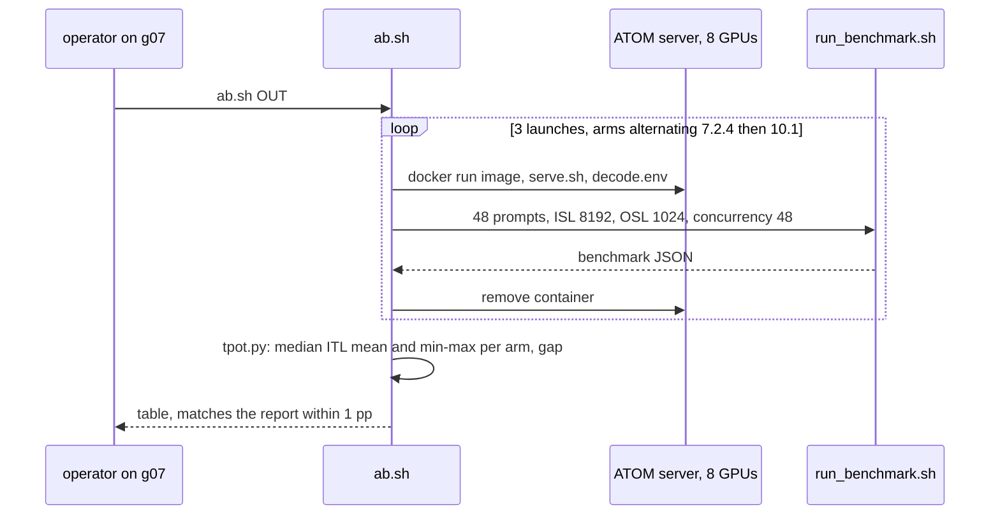
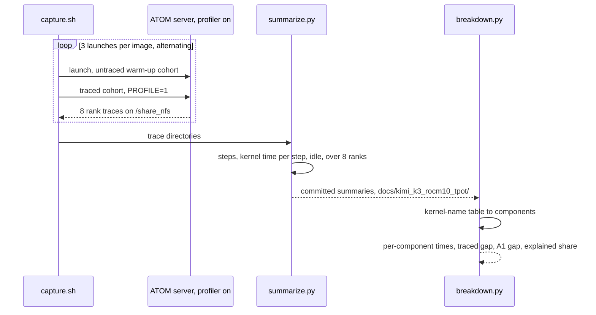
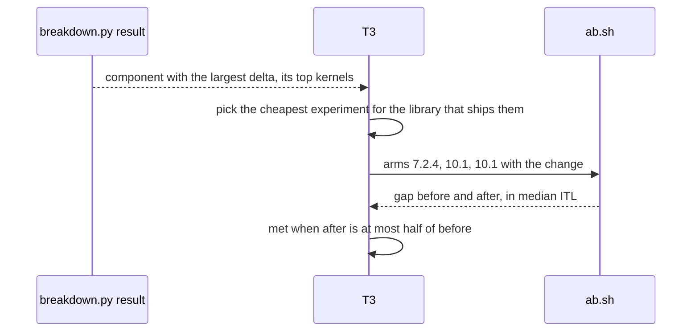

# Kimi-K3 decode TPOT on ROCm 10.1: investigation design

Design for junyyang-amd/ATOM#63, under #62: how to reproduce the Kimi-K3
decode gap between `rocm/atom-dev:ROCm_10.1.0` (10.1) and
`rocm/atom-dev:nightly_202611021458` (7.2.4) on one node, how to break one
decode step's GPU time into components, and how to confirm a cause. The
requirement (goals, acceptance A1 to A4, scope, non-goals) is #62's; this
document says how to meet it. Decisions are weighed against
[`agent_team_principles.md`](agent_team_principles.md).

Terms: a **step** is one decode iteration on the GPU (the target forward,
the DSpark draft and its KV write), emitting 3.36 tokens per request on
average under the forced acceptance length. **Median ITL** is the
benchmark's median gap between streamed chunks, one chunk per step. A
**launch** is one server start with its cohort of 48 requests. An **arm**
is one image, plus any change an experiment makes to it.

## Scenarios

### A1: the gap on one node



If the two arms' ranges overlap on g07, the report says so and names the
environment factor in place of A2 and A3, as A1 states. T1 then
escalates: the tasks after it change.

### A2: per-step breakdown



When the traced gap is not positive beyond both images' launch ranges, the
breakdown is not reported; T2 diagnoses the tracing difference (D13).

### A3: confirming experiment



A failed experiment is replaced by the next cheapest one on the same
component, then the next component; each try is a report entry.

### A4: follow-up issue

```
T3 confirms: component X, kernel K, library L
        |
        v
T4: gh issue create --label agent-team/backlog, title with "TPOT"
    body: component X, repository of L, candidate owner
        |
        v
report ## Follow-up links the issue
```

## Acceptance

| Item | Task | Check, run on pit2-p03-g07 from the repository root |
|---|---|---|
| A1 | T1 | `bash scripts/kimi_k3_tpot/ab.sh <out-dir>` |
| A2 | T2 | `python3 scripts/kimi_k3_tpot/breakdown.py docs/kimi_k3_rocm10_tpot` |
| A3 | T3 | the `ab.sh` command with the experiment arm, as the report's `## Confirm` gives it |
| A4 | T4 | `gh issue list --repo junyyang-amd/ATOM --label agent-team/backlog --search "TPOT"` |

The A2 check reads only committed files and needs no GPU.

## Decisions

Code facts were checked at `fork/kimi-k3-tpot` ecaf034ce.

### What runs

**D1. Each image runs its own ATOM for every timing run.** Basis: code:
the images carry ATOM 974414f16 (7.2.4) and 6270386de (10.1) on merge base
606aceb11; the first adds MoRI WideEP (`atom/model_ops/moe.py:
use_mori_low_latency`, `atom/model_ops/fused_moe/mori_prepare_finalize.py`)
and the multi-node DP timeout (`atom/utils/distributed/utils.py:
raise_timeout_if_dp_spans_nodes`), the second only
`atom/model_loader/loading_core.py`; none runs on the DCP8 DSpark decode
step. principle: Settings follow the CI case (CI ran
`ATOMESH_ATOM_SOURCE=image`). Rejected: one ATOM tree mounted in both
images, which runs 10.1's loader on 7.2.4's torch for no measured gain.

**D2. One case: `1p1d-dcp8-dspark4` c48's decode settings.** Basis:
`.github/benchmark/models_atomesh.yaml: kimi_k3_agentic_hc_dspark4` (the
1p2d case reuses its decode settings); the earlier tables
(`/share_nfs/junyan_tmp_r120/logs/perf-cmp/rocm10.1-vs-7.2.4-tables.md`)
hold two runs per image for it and one for `dspark3` c8. principle: the
simplest solution that meets acceptance; A1 to A3 each ask for one gap.
Rejected: all three cases, three times the GPU hours for figures no
acceptance item reads.

**D3. Flags and env are the CI decode server's, minus the KV connector.**
The decode `openai_server` command and `ATOMESH_DECODE_ENV_*` of CI Slurm
11899 (10.1) and 12390 (7.2.4) are identical apart from the proxy IP;
`--kv-transfer-config` and the mooncake env are dropped, and
`ATOM_MONO_ENABLE=0` keeps the CI's decode path, since the CI logs "mono
decode off: KV connector". Basis: spike #64 (`serve.sh`, `decode.env` at
PR #71's head); principle: Settings follow the CI case. Rejected: launching
through `pd_server_atom.sh` from a `pd_matrix.py` cell, which expects
Slurm, the router and a PD peer.

**D4. One ATOM server on all 8 GPUs of pit2-p03-g07.** Basis: spike #64
measured this setup on g08 with the decode step slower on 10.1 at both
ISLs; principle: Run only on the node the owner named; g07 carries both
images with the image IDs #64 ran (c9f5678138ba, b0029ebfa2f7). T1
re-measures on g07 before anything compares with it. Rejected: the CI's
1P1D over two nodes, which A1 and principle 3 rule out.

**D5. Workload: one cohort per launch, ISL 8192, A1's figure is median
ITL.** 48 random prompts, OSL 1024, concurrency 48,
`RANDOM_RANGE_RATIO=1.0`, through `scripts/run_benchmark.sh`, as the
first cohort after the server is ready. Basis: #64's handoff: the
benchmark's median TPOT includes each request's wait for the other
prefills and shows no gap beyond the ranges, while median ITL shows +2.4%
to +3.0% at ISL 8192 with the ranges apart in all three runs; at ISL 65536
they overlap in two of three. A1 allows per-step decode time. Steady TPOT
is printed beside it; it is masked at ISL 8192 by 7.2.4-only stalls
(#64). Rejected: a warm-up cohort first, which departs from the only setup
with data for an effect (#65's warm-up) seen in mean TPOT, not median ITL.

**D6. One A1 run is one launch; launches alternate between arms.** Basis:
principle: A number has a spread and Compare like with like: the CI gap
compared different launches, and alternation keeps node drift off one arm.
Rejected: three cohorts on one launch, whose spread omits launch-to-launch
variance.

**D7. One launcher for every run.** `serve.sh` and `decode.env` serve A1,
A2 and A3; a capture adds only `--torch-profiler-dir`,
`ATOM_PROFILER_MORE=0`, `PROFILE=1` on the cohort and, in 10.1, the
`/app/ATOM` mount (D8). Basis: principle: Compare like with like; #65's
`capture.sh` restated the flags by hand and lacks `ATOM_MONO_ENABLE=0`,
`ATOM_ENABLE_METRICS_DEVICE_TIMER=1` and the NCCL env, so its traces ran
another decode path than #64's timings. Rejected: landing #65's
`capture.sh` as the A2 launcher.

### What is traced

**D8. ATOM's kineto profiler; 10.1 runs this line's tree at `/app/ATOM`.**
Basis: spike #65: with #73's fix, 10.1 traces record kernels replayed from
CUDA graphs and the `decode`, `propose_dspark`, `draft_kv` windows; the
image's own ATOM records no GPU events. code: `git diff 6270386de
fork/kimi-k3-tpot -- atom/` touches only `atom/model_engine/async_proc.py:
AsyncIOProcManager.__init__` (the unset) and `atom/mesh/proto/
manifest.json`, so the traced 10.1 server differs from A1's only in its
workers' environment. 7.2.4 traces through roctracer and keeps GPU events
in its own ATOM (#70). Rejected: this line's tree in both images (D1).

**D9. Three launches per image, alternating; per launch an untraced
warm-up cohort, then one traced cohort with D5's workload.** Basis: #65's
handoff (the first traced cohort is a warm-up: mean TPOT about 25 ms
against 16, traces 4x larger); principle: A number has a spread. Rejected:
three traced cohorts on one launch per image, which drops the launch
variance A1 includes.

**D10. A step runs from the start of one pure-decode window to the start
of the next step window; overlapping kernels share time equally.** A
pure-decode window is a `gpu_user_annotation` `decode[bs=48 ...]` with no
`p=` field; the next window is any `decode[`, `prefill[` or their
`dummy_`/`eager_` forms, and a window repeated on a second stream counts
once (#65's `inspect_trace.py: iterations`). Each instant of a step is
divided equally among the kernels running then; an instant with none is
idle. Component times plus idle then sum to the step time, and their deltas
to the gap. Basis: code: `atom/model_engine/run_labels.py:
build_run_label` writes `p=` only when the batch holds a prefill;
`tools/parse_trace.py: union_duration` notes that kernels on concurrent
streams overlap. Rejected: summing kernel durations per component, which
counts overlap twice, so the deltas need not add up to the gap.

**D11. Components come from a checked-in table of kernel-name patterns.**
The table maps names to MLA attention, KDA, MoE, GEMM and communication;
a kernel matches its first pattern; unmatched kernels and idle make up
"other", printed as two lines. Explained share = (gap minus other's delta)
/ gap. Basis: A2 names these components and kernel names carry them
(`_replayssm_kda_fwd_kernel`, `opus_moe_sorting_entry`,
`cross_device_reduce_2stage`, `f4gemm_bf16_per1x32Fp4_*` in the 7.2.4-era
CI trace); principle: Unit tests run without a GPU. Rejected:
`tools/parse_trace.py`'s module mapping, which needs `--mark-trace`
captures, reads only the first decode (`find_first_decode`) and yields
layers, not components.

**D12. All 8 ranks, averaged per kernel name.** Basis: under DCP8 a slow
rank shows as communication wait on the others, so one rank's trace books
its delay to communication. Rejected: rank 0 only.

**D13. A2's denominator is the traced gap, checked against A1.** The
breakdown divides by the gap of the traced captures' mean step time, so
components, idle and gap come from one capture, and prints A1's median-ITL
gap beside it. If the traced gap is not positive beyond both images'
launch ranges, T2 stops and diagnoses before reporting a share. Basis: the
two images trace through different back ends (rocprofiler-sdk on 10.1,
roctracer on 7.2.4; #70), so whether tracing shifts the gap is unmeasured,
and the stop catches a shift that matters without an extra run. Rejected:
A1's untraced gap as denominator, which pushes any tracing cost into
"other" and stops the share adding up.

**D14. Raw traces stay on `/share_nfs`; per-image summaries are
committed.** `summarize.py` writes one JSON per image to
`docs/kimi_k3_rocm10_tpot/`: per launch the step count, mean step time and
idle, and per kernel name its time per step averaged over ranks, one
kernel per line. Basis: overlay body (raw traces never in git); A2 checks
"on the committed trace summaries". It reuses
`tools/analyze_trace_summary.py: load_trace_events, parse_label`.
Rejected: committing component totals only, which would need the raw
traces to re-run a corrected pattern table.

### Confirm and follow up

**D15. A3's experiment follows A2's figures, cheapest first.** Take the
component with the largest positive delta, then its top kernels by delta;
the library that ships them (aiter, hipBLASLt, Triton, torch, RCCL)
decides the experiment: an env var or kernel choice first, a library swap
last. `ab.sh` runs three arms alternating in one session (7.2.4, 10.1,
10.1 with the change; 3 launches each), and prints before (10.1 minus
7.2.4) and after (changed 10.1 minus 7.2.4) in median ITL. An arm is an
image plus a file of extra `docker run` arguments (an env entry or a
library mount). Basis: principle: Measure before deciding (the choice needs
A2's numbers); Compare like with like (before and after in one session).
Rejected: "before" from the report's A1 figures, which saves one arm
(about 30 minutes on g07) but compares runs from different days.

**D16. A4 is one backlog issue, filed by T4.** Labeled
`agent-team/backlog`, no `Part of` line, "TPOT" in its title, its body
naming the component, the repository and a candidate owner: the most
frequent committer in the last six months to the kernel's source file in
that repository. Basis: A4's check; `rules.md`, The task record (work
outside the feature goes to the backlog; the fix is a non-goal of #62).
Rejected: filing it from T3's handoff, which leaves A4 without a task.

### Where things live

**D17. One directory `scripts/kimi_k3_tpot/`, one test file, a separate
report.** Code: `serve.sh`, `decode.env`, `ab.sh` (A1, A3), `tpot.py`,
`capture.sh`, `summarize.py`, `breakdown.py` with its pattern table.
Tests: `tests/test_kimi_k3_tpot.py`, importing the scripts through
`sys.path` as `tests/test_otel_otlp_process.py` imports
`scripts/observability/`. Results: `docs/kimi_k3_rocm10_tpot_report.md`
with `## Reproduce`, `## Breakdown`, `## Confirm` and `## Follow-up`,
listed in `CLAUDE.md`. Basis: principle: Follow the project's existing
conventions (`scripts/` holds launch scripts and their Python helpers);
a design document holds decisions, a report holds figures later runs
replace. Rejected: the analysers in `tools/` beside `parse_trace.py`,
which splits one investigation over two directories.

## Simpler alternative

Land the two spikes' scripts as they are: #64's `run.sh` for A1 and A3,
#65's `capture.sh` and `inspect_trace.py` for A2, with one traced launch
per image, rank 0 only, and per-component sums of kernel durations. About
half the code of D7 to D14.

It fails A2 and a principle. `capture.sh` runs another decode path than
`run.sh` (D7), against Compare like with like; one traced launch per image
has no spread, against A number has a spread; and summed durations do not
add up to the gap across two streams (D10), so A2's explained share has
no fixed meaning.

## Low confidence

No decision is `low`. Two risks to meeting A2, each checked by its task:

- Tracing may move the gap (D13): T2 stops and diagnoses if the traced gap
  is not beyond both ranges.
- The gap may sit mostly in idle time, between graph replays, which A2
  counts under "other": T2 then reports the share it finds and escalates,
  since the requirement names no idle component.

## Dependencies

| Issue | Result | PR, head |
|---|---|---|
| #64, spike | One node, g08: 10.1's decode step slower, median ITL +2.4% to +3.0% at ISL 8192 (ranges apart), +0.9% to +1.8% at ISL 65536 | #71 (closed), 4084fe31ac75def8702a0780e560604998dbe29f |
| #65, spike | ATOM's server traces on 10.1 held no GPU events: workers inherited `ROCPROFILER_REGISTER_LIBRARY`; with it unset, kernels and step windows are recorded | #70 (closed), 7825dc440c27170a5f3224bd6ba24eae9d6a5df2 |
| #66 | `scripts/run_benchmark.sh` and `scripts/start_atom_server.sh` fall back to `amd-smi` on 10.1 | #67, landed as 6ab1dcb3f |
| #72 | `AsyncIOProcManager.__init__` unsets the variable before spawning workers | #73, landed as ecaf034ce |

No interface here exists only upstream, so no sync issue is needed.

## Summary

**Deliverable**: a one-node A/B reproduction on g07, a per-step component
breakdown of both images, one confirming experiment and a backlog issue
for the fix, with the report `docs/kimi_k3_rocm10_tpot_report.md`.

**Scope**: D2's case at ISL 8192, one 8-GPU server on pit2-p03-g07, each
image's own ATOM (10.1 traces on this line's tree). A1 to A3 are defined
on the gap A1 measures on one node, which #64 found at about half to
two-thirds of the CI's 4-5%; the report states both, and the rest of the
CI gap lies outside A2's denominator.

**Non-goals**: as #62, and the `1p2d-dcp8-dspark4` and `dspark3` cases.

**Changes per file**

- `scripts/kimi_k3_tpot/serve.sh`, `decode.env`: the server (D3, D7).
- `scripts/kimi_k3_tpot/ab.sh`, `tpot.py`: launches by arm, the A1 and A3
  table (D5, D6, D15).
- `scripts/kimi_k3_tpot/capture.sh`, `summarize.py`, `breakdown.py`:
  traced launches, summaries, components (D8 to D14).
- `tests/test_kimi_k3_tpot.py`: `tpot.py`, `summarize.py` and
  `breakdown.py` on synthetic benchmark JSON and traces.
- `docs/kimi_k3_rocm10_tpot/`: committed summaries (D14).
- `docs/kimi_k3_rocm10_tpot_report.md`, `CLAUDE.md`: the report and its
  row (D17).

**Tasks**, in order, each depending on the one before:

| Task | Item | Builds | Named result | Effort, code / test |
|---|---|---|---|---|
| T1 | A1 | `serve.sh`, `decode.env`, `ab.sh`, `tpot.py`, test, report `## Reproduce`, `CLAUDE.md` row | `ab.sh` on g07: per image the mean and min-max median ITL over 3 launches, and the gap | 220 / 60 |
| T2 | A2 | `capture.sh`, `summarize.py`, `breakdown.py` and table, tests, summaries, `## Breakdown` | `breakdown.py` on the committed summaries: per-component times of both images and an explained share of at least 80% | 300 plus about 400 summary lines / 120 |
| T3 | A3 | the experiment's arm file, `ab.sh` arms, `## Confirm` | the three-arm `ab.sh` run: after at most 50% of before | 60 / 20 |
| T4 | A4 | the backlog issue, `## Follow-up` | A4's `gh issue list` showing one issue naming component, repository and candidate owner | 15 / 0 |

T1's tests exercise `tpot.py` on benchmark JSON in the shape
`atom.benchmarks.benchmark_serving --save-detailed` writes; T2's exercise
`summarize.py` on traces in the shape `build_run_label` labels and
`breakdown.py` on its output.
