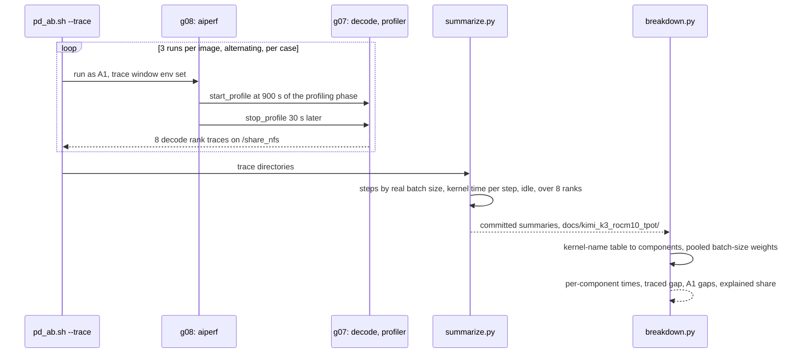
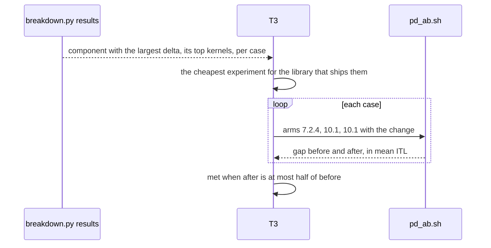

# Kimi-K3 decode TPOT on ROCm 10.1: investigation design

Design for junyyang-amd/ATOM#63, under #62: how to reproduce the Kimi-K3
decode gap between `rocm/atom-dev:ROCm_10.1.0` (10.1) and
`rocm/atom-dev:nightly_202611021458` (7.2.4) in the CI's 1P1D topology on
pit2-p03-g07 and g08, how to break one decode step's GPU time into
components, and how to confirm a cause. The requirement (goals, acceptance
A1 to A4, scope, non-goals) is #62's; this document says how to meet it.
Decisions are weighed against
[`agent_team_principles.md`](agent_team_principles.md).

Terms: a **case** is one of #62's ATOMesh cells,
`kimi-k3-mxfp4-1p1d-tp8-dcp8-dspark4-agentic-lmcache-1m` at concurrency 48
(dspark4 c48) or `kimi-k3-mxfp4-1p1d-tp8-dcp8-dspark3-agentic-lmcache-1m`
at concurrency 8 (dspark3 c8). A **run** is one 1P1D launch of a case: a
prefill container on g08, a decode container on g07, the KV cache moving
between them over RDMA, and one aiperf benchmark through the ATOMesh
router. A **step** is one decode iteration on the decode node's GPUs (the
target forward, the DSpark draft and its KV write). An **arm** is one image,
plus any change an experiment makes to it.

## Scenarios

### A1: the gap in the 1P1D topology

```mermaid
sequenceDiagram
    participant O as operator
    participant L as pd_ab.sh
    participant P as g08 rank 0: prefill, router, aiperf
    participant D as g07 rank 1: decode
    participant I as itl.py
    O->>L: pd_ab.sh CASE OUT
    loop 3 runs per image, images alternating
        L->>P: GPU-idle check, docker run, pd_server_atom.sh, case env
        L->>D: GPU-idle check, docker run, pd_server_atom.sh, case env
        P->>D: KV cache over mooncake RDMA, per request
        P-->>L: aiperf results under OUT
        L->>P: remove own container
        L->>D: remove own container
    end
    L->>I: OUT
    I-->>O: per image mean ITL, mean and min-max; gap
```

The operator runs it once per case. When a case's two ranges overlap, the
report says so for that case and names the environment factor in place of
its A2 and A3, as A1 states; T1 escalates, because the tasks after it
change.

### A2: per-step breakdown



When the traced gap is not positive beyond both images' run ranges, the
breakdown is not reported; T2 diagnoses the tracing difference (D14).

### A3: confirming experiment



A failed experiment is replaced by the next cheapest one on the same
component, then the next component; each try is a report entry.

### A4: follow-up issue

```
T3 confirms: component X, kernel K, library L
        |
        v
T4: gh issue create --label agent-team/backlog, title with "TPOT"
    body: component X, repository of L, candidate owner
        |
        v
report ## Follow-up links the issue
```

## Acceptance

| Item | Task | Check, from the repository root on a host that reaches both nodes over ssh |
|---|---|---|
| A1 | T1 | `bash scripts/kimi_k3_tpot/pd_ab.sh <case> <out-dir>`, once per case |
| A2 | T2 | `python3 scripts/kimi_k3_tpot/breakdown.py docs/kimi_k3_rocm10_tpot` |
| A3 | T3 | the `pd_ab.sh` command with the experiment arm, as the report's `## Confirm` gives it |
| A4 | T4 | `gh issue list --repo junyyang-amd/ATOM --label agent-team/backlog --search "TPOT"` |

The A2 check reads only committed files and needs no GPU.

## Decisions

Code facts were checked at `fork/kimi-k3-tpot` ecaf034ce; CI facts in
`/share_nfs/ATOMESH_RUNNER/ATOMESH_LOG/<case>-<runid>-<ts>/slurm_job-<id>/`.

### What runs

**D1. Each image runs its own ATOM for every timing run.** Basis: code:
the images carry ATOM 974414f16 (7.2.4) and 6270386de (10.1) on merge base
606aceb11; the first adds MoRI WideEP (`atom/model_ops/moe.py:
use_mori_low_latency`, `atom/model_ops/fused_moe/mori_prepare_finalize.py`)
and the multi-node DP timeout (`atom/utils/distributed/utils.py:
raise_timeout_if_dp_spans_nodes`), the second only
`atom/model_loader/loading_core.py`; none runs on the DCP8 DSpark decode
step. principle: Settings follow the CI case (the CI env sets
`ATOMESH_ATOM_SOURCE=image`). Rejected: one ATOM tree mounted in both
images, which runs 10.1's loader on 7.2.4's torch for no measured gain.

**D2. Both 1P1D cases, each measured and broken down on its own; `1p2d`
is out.** Basis: requirement: #62 Goal 1 and A1, as the Ruling on #63
set them. The cases differ in draft depth (4 against 3), acceptance length
(3.36 against 3.00), concurrency and `ATOM_STATE_CHECKPOINT_DEMAND`, so
one cannot stand for the other. Rejected: dspark4 c48 standing for both,
which the Ruling overturned.

**D3. Settings are the CI's env files of the reference runs, launched
through the CI's own `pd_server_atom.sh`.**
`scripts/kimi_k3_tpot/cases/<case>.env` holds `docker-rank-0.env` of
Slurm 11899 (dspark4 c48) and 12189 (dspark3 c8) without `DOCKER_IMAGE`
and `ATOMESH_RUN_TOKEN`, which `pd_ab.sh` sets per run. Each image's CI
env is identical to the other's apart from those two lines (11899 against
12390, 12189 against 24916). Inside each container `pd_ab.sh` runs
`.github/scripts/atomesh/pd_server_atom.sh` from this line's tree,
mounted read-only at `/workspace/ATOM` as CI mounts its checkout, so the
server flags, the per-role env (`ATOMESH_PREFILL_ENV_*`,
`ATOMESH_DECODE_ENV_*`), the KV connector (`kv_transfer_config`: mooncake
producer plus lmcache offload on prefill, mooncake consumer on decode) and
the aiperf call are the CI's. Basis: principle: Settings follow the CI
case; code: `pd_slurm_job.sh: write_env_file` writes these files from the
variables the container reads. Rejected: regenerating the env from
`pd_matrix.py` at this tree, which reproduces the YAML as it is now rather
than as it ran in the reference runs, and whose variable export lives in
`pd_submit.sh`'s Slurm submit path.

**D4. Prefill, router and aiperf on g08 (rank 0); decode on g07
(rank 1).** Basis: code: `pd_server_atom.sh` starts prefill, the ATOMesh
router and the benchmark on rank 0 and decode on rank `xP`; principle: Run
only on the nodes the owner named. The decode step is the measured role,
and g07 runs no one else's work, while g08 hosts another user's
`fxr_up_*` containers (docker ps, 2026-11-16) whose CPU load would land in
the decode node's host time between graph replays. Rejected: decode on
g08, as CI 11899 and 24916 placed it, which puts uncontrolled neighbours
under the measured role. #64's one-node data came from g08 alone and is not
compared with these runs.

**D5. `pd_ab.sh` replaces `pd_slurm_job.sh`; it touches only its own
containers.** Per run it checks both nodes' GPUs idle, as
`pd_slurm_job.sh: assert_gpus_idle` does, and stops if not; starts
`kimi-tpot-63-prefill` on g08 and `kimi-tpot-63-decode` on g07 over ssh
with `pd_slurm_job.sh: run_container_rank`'s docker flags and env
(`NODE_RANK`, `IPADDRS`, `NODE0_ADDR`, `xP`, `yD`, the NCCL and MoRI
settings); waits for rank 0 to exit; and removes both. Deviations, each
stated in the report: the HCA lists name the nodes' own devices
(`rdma0`-`rdma7`, from `/sys/class/infiniband`) where CI names
`ionic_0`-`ionic_7`; logs and traces go under
`/share_nfs/junyan_tmp_r120/kimi-k3-tpot/`. Basis: code:
`pd_slurm_job.sh: pre_cleanup_nodes` stops every running container on
each node, which would stop the `fxr_up_*` containers, and the script
reads its nodes from a Slurm allocation; local file: never touch another
user's container, no `--privileged` (`run_container_rank` uses none).
Rejected: submitting the CI job through Slurm, for the pre-cleanup above.

**D6. No `ATOM_MONO_ENABLE` setting.** With the CI's KV connector the
decode server turns mono decode off itself. Basis: code:
`atom/models/kimi_k3/mono/dispatch.py: install_mono_decode` logs "Kimi-K3
mono decode off" with `config_refusal`'s reason; the decode logs of CI
11899 and 12390 read "mono decode off: KV connector". #64 needed the
variable only because it dropped the connector. Rejected: setting it
anyway, an env the CI does not set.

**D7. Workload: the case's own aiperf agentic replay; A1's figure is
aiperf's mean ITL.** The env files keep the CI benchmark: the
`semianalysis_cc_traces_weka_062126` traces, a warm-up of 10 requests per
lane, a 3600 s profiling phase. A1 prints `mean_itl_ms` from
`benchmark_results/*.json`, the CI tables' TPOT column (`perf-cmp/
collect.py` reads it as `tpot`; Slurm 11899: 14.95 ms), and median ITL
beside it. Both images force the same acceptance length, so an ITL ratio
is a step-time ratio. Basis: principle: Settings follow the CI case; #64:
a figure that includes each request's wait for others' prefills hides the
step, while ITL shows it. The prefill-first stalls #64 saw cannot reach the
decode node, which runs no prefill. Rejected: a shorter profiling phase,
which saves about an hour per run but changes the replay's cache and batch
history by an amount nobody has measured.

**D8. One A1 run is one launch pair; runs alternate between images.**
Three runs per image per case, the cases one after the other. Basis:
principle: A number has a spread; Compare like with like: alternation
keeps node drift off one arm. Rejected: three benchmarks on one launch,
whose spread omits launch-to-launch variance.

**D9. One launcher for every run.** A1, A2 and A3 all go through
`pd_ab.sh` and the case env; a traced run adds only the profile-window
env (D11) and, in 10.1, this line's tree at `/app/ATOM` (D10); an
experiment arm adds only its file of extra `docker run` arguments (D17).
Basis: principle: Compare like with like; #65's `capture.sh` restated
flags by hand and drifted from #64's. Rejected: a separate capture
launcher.

### What is traced

**D10. ATOM's kineto profiler; 10.1 runs this line's tree at
`/app/ATOM`.** Basis: spike #65: with #73's fix, 10.1 traces record
kernels replayed from CUDA graphs and the `decode`, `propose_dspark`,
`draft_kv` windows; the image's own ATOM records no GPU events. code: `git
diff 6270386de fork/kimi-k3-tpot -- atom/` touches only
`atom/model_engine/async_proc.py: AsyncIOProcManager.__init__` (the unset)
and `atom/mesh/proto/manifest.json`, so the traced 10.1 server differs
from A1's only in its workers' environment. 7.2.4 traces through
roctracer and keeps GPU events in its own ATOM (#70). Rejected: this
line's tree in both images (D1).

**D11. The CI's profile window: decode only, from 900 s into the
profiling phase, for 30 s; three traced runs per image per case,
alternating.** `pd_ab.sh --trace` sets `ATOMESH_TORCH_PROFILE_START=900`,
`ATOMESH_TORCH_PROFILE_DURATION=30` and
`ATOMESH_TORCH_PROFILE_ROLES=decode` through `ATOMESH_ENV_`, as CI Slurm
11091 did. Basis: code: `pd_server_atom.sh: run_torch_profile_window`
opens the window counted from aiperf's profiling phase and stops aiperf
once every trace is on disk; 11091 used these start and duration values on
a Kimi-K3 dspark4 case (306 MB per decode node). The window opens after
aiperf's warm-up and 900 s of load, past the first-cohort warm-up #65 saw.
principle: A number has a spread. Rejected: tracing inside A1's runs,
which saves the traced runs but ends each A1 run at 930 s, since the
window stops aiperf.

**D12. A step runs from the start of one pure-decode window to the start
of the next step window; overlapping kernels share time equally.** A
pure-decode window is a `gpu_user_annotation` whose name starts `decode[`
and has no `p=` field; its real batch size is `N` in either `bs=N` or
`bs=N/M` (padded to a graph of `M`). The next window is any `decode[`,
`prefill[` or their `dummy_`/`eager_` forms; a window repeated on a second
stream counts once (#65's `inspect_trace.py: iterations`). Each instant of
a step is divided equally among the kernels running then; an instant with
none is idle. Component times plus idle sum to the step time. Basis: code:
`atom/model_engine/run_labels.py: build_run_label` writes `p=` only when
the batch holds a prefill and `bs=<scheduled>/<graph>` when padded;
`tools/parse_trace.py: union_duration` notes that kernels on concurrent
streams overlap. Rejected: summing kernel durations per component, which
counts overlap twice, so deltas need not add up to the gap.

**D13. Steps are averaged per real batch size, then weighted by both
images' pooled batch-size histogram.** Under agentic replay the batch size
moves from step to step, so the per-step time of an image and each
component's time are means over its steps at each batch size, combined
with one weight per size, the same for both images. Weighting is linear,
so component deltas still sum to the gap. Basis: principle: Compare like
with like. Rejected: a plain mean over all steps, which a shift in batch
mix between runs moves by as much as the gap itself.

**D14. A2's denominator is the traced gap, printed beside two A1 gaps.**
The breakdown divides by the traced per-step gap (D13), so components,
idle and gap come from one capture. Beside it it prints A1's mean-ITL gap
over the same position, seconds 900 to 930 of the profiling phase, from
A1's `profile_export_aiperf_timeslices.csv` (one slice per second,
`AIPERF_SLICE_DURATION=1`), and A1's whole-hour gap. If the traced gap is
not positive beyond both images' run ranges, T2 stops and diagnoses before
reporting a share. Basis: the images trace through different back ends
(rocprofiler-sdk on 10.1, roctracer on 7.2.4; #70), so whether tracing
shifts the gap is unmeasured, and the stop catches a shift that matters;
the aligned slice compares traced and untraced at one position with no
extra run. Rejected: A1's whole-hour gap alone, which compares a 30 s
window with an hour.

**D15. Components come from a checked-in table of kernel-name patterns.**
The table maps names to MLA attention, KDA, MoE, GEMM and communication;
a kernel matches its first pattern; unmatched kernels and idle make up
"other", printed as two lines. Explained share = (gap minus other's delta)
/ gap. Basis: A2 names these components and kernel names carry them
(`_replayssm_kda_fwd_kernel`, `opus_moe_sorting_entry`,
`cross_device_reduce_2stage`, `f4gemm_bf16_per1x32Fp4_*` in CI Slurm
11091's decode trace); principle: Unit tests run without a GPU. Rejected:
`tools/parse_trace.py`'s module mapping, which needs `--mark-trace`
captures, reads only the first decode (`find_first_decode`) and yields
layers, not components.

**D16. All 8 decode ranks, averaged per kernel name; raw traces stay on
`/share_nfs`, per-case per-image summaries are committed.** Under DCP8 a
slow rank shows as communication wait on the others, so one rank's trace
books its delay to communication. `summarize.py` writes one JSON per case
and image to `docs/kimi_k3_rocm10_tpot/`: per run the step count, step
time and idle per real batch size, and per kernel name its time per step
averaged over ranks, one kernel per line. It reuses
`tools/analyze_trace_summary.py: load_trace_events, parse_label`. Basis:
overlay body (raw traces never in git); A2 checks "on the committed trace
summaries". Rejected: rank 0 only; committing component totals only, which
would need the raw traces to re-run a corrected pattern table.

### Confirm and follow up

**D17. A3's experiment follows A2's figures, cheapest first, in both
cases.** Take the component with the largest positive delta, then its top
kernels by delta; the library that ships them (aiter, hipBLASLt, Triton,
torch, RCCL, mooncake) decides the experiment: an env var or kernel
choice first, a library swap last. `pd_ab.sh` runs three arms alternating
in one session per case (7.2.4, 10.1, 10.1 with the change; 3 runs each)
and prints before (10.1 minus 7.2.4) and after (changed 10.1 minus 7.2.4)
in mean ITL. An arm is an image plus a file of extra `docker run`
arguments for both containers (an env entry or a library mount). When A2
puts the cases' largest deltas in different components, so that no one
experiment serves both, T3 escalates: A3 asks for one experiment. Basis:
requirement: Goal 1 covers both cases; principle: Measure before deciding
(the choice needs A2's numbers), Compare like with like (before and after
in one session). Rejected: "before" from the report's A1 figures, which
saves an arm but compares runs from different days.

**D18. A4 is one backlog issue, filed by T4.** Labeled
`agent-team/backlog`, no `Part of` line, "TPOT" in its title, its body
naming the component, the repository and a candidate owner: the most
frequent committer in the last six months to the kernel's source file in
that repository. Basis: A4's check; `rules.md`, The task record (the fix
is a non-goal of #62). Rejected: filing it from T3's handoff, which leaves
A4 without a task.

### Where things live

**D19. One directory `scripts/kimi_k3_tpot/`, one test file, a separate
report.** Code: `pd_ab.sh` (A1, A2, A3), `cases/` (the env files),
`itl.py` (A1 and A3 tables, the aligned window of D14), `summarize.py`,
`breakdown.py` with its pattern table. Tests: `tests/test_kimi_k3_tpot.py`,
importing the scripts through `sys.path` as
`tests/test_otel_otlp_process.py` imports `scripts/observability/`.
Results: `docs/kimi_k3_rocm10_tpot_report.md` with `## Reproduce`,
`## Breakdown`, `## Confirm` and `## Follow-up`, listed in `CLAUDE.md`.
Basis: principle: Follow the project's existing conventions; a design
document holds decisions, a report holds figures later runs replace.
Rejected: the launcher beside the CI scripts in `.github/scripts/atomesh/`,
where the CI does not run it.

## Simpler alternative

Run the CI's `pd_slurm_job.sh` on g07 and g08 through Slurm, unchanged,
and break down one traced run per image with summed kernel durations on
rank 0. No launcher to write.

It fails a principle and A2. `pd_slurm_job.sh: pre_cleanup_nodes` stops
every container on both nodes, another user's on g08 included, against
Run only on the nodes the owner named and the local rule never to touch
another user's container; one traced run per image has no spread, against
A number has a spread; and summed durations do not add up to the gap
across two streams (D12), so A2's explained share has no fixed meaning.

## Low confidence

No decision is `low`. Risks to meeting A2, each checked by its task:

- Tracing may move the gap (D14): T2 stops and diagnoses if the traced gap
  is not beyond both ranges.
- The gap may sit mostly in idle time between graph replays, where the
  decode node's KV receive and scheduling run; A2 counts it under "other".
  #64's one-node gap, without a KV connector, was about half to
  two-thirds of the CI's, which makes this likelier. T2 then reports the
  share it finds and escalates, since the requirement names no idle
  component.

## Dependencies

| Issue | Result | PR, head |
|---|---|---|
| #64, spike | One node, g08, no KV connector: 10.1's decode step slower, median ITL +2.4% to +3.0% at ISL 8192 (ranges apart), +0.9% to +1.8% at ISL 65536; median TPOT with request waits shows no gap | #71 (closed), 4084fe31ac75def8702a0780e560604998dbe29f |
| #65, spike | ATOM's server traces on 10.1 held no GPU events: workers inherited `ROCPROFILER_REGISTER_LIBRARY`; with it unset, kernels and step windows are recorded; the first traced cohort after start is a warm-up | #70 (closed), 7825dc440c27170a5f3224bd6ba24eae9d6a5df2 |
| #66 | `scripts/run_benchmark.sh` and `scripts/start_atom_server.sh` fall back to `amd-smi` on 10.1 | #67, landed as 6ab1dcb3f |
| #72 | `AsyncIOProcManager.__init__` unsets the variable before spawning workers | #73, landed as ecaf034ce |

No interface here exists only upstream, so no sync issue is needed.

## Summary

**Deliverable**: a 1P1D A/B reproduction of both cases on g07 and g08, a
per-step component breakdown of both images per case, one confirming
experiment and a backlog issue for the fix, with the report
`docs/kimi_k3_rocm10_tpot_report.md`.

**Scope**: dspark4 c48 and dspark3 c8 in the CI's 1P1D topology, prefill
on g08 and decode on g07, with the CI's env, launch script, KV connector
and aiperf replay, each image's own ATOM (10.1 traces on this line's
tree). A1 to A3 target the gap these runs show, which is the CI
topology's.

**Non-goals**: as #62, `1p2d-dcp8-dspark4` c48 included (deferred by the
Ruling on #63).

**GPU time**, from CI Slurm 11899 (about 2 h per untraced run, load to
shutdown): A1 about 24 h of the node pair, A2 about 14 h (runs end after
the trace window), A3 about 36 h per experiment tried. Only one 1P1D run
fits the two nodes at a time.

**Changes per file**

- `scripts/kimi_k3_tpot/pd_ab.sh`, `cases/*.env`: the launcher and the
  CI settings (D3 to D9, D11).
- `scripts/kimi_k3_tpot/itl.py`: the A1 and A3 tables and D14's aligned
  window gap.
- `scripts/kimi_k3_tpot/summarize.py`, `breakdown.py`: summaries,
  components (D12 to D16).
- `tests/test_kimi_k3_tpot.py`: `itl.py`, `summarize.py` and
  `breakdown.py` on synthetic aiperf output and traces.
- `docs/kimi_k3_rocm10_tpot/`: committed summaries (D16).
- `docs/kimi_k3_rocm10_tpot_report.md`, `CLAUDE.md`: the report and its
  row (D19).

**Tasks**, in order, each depending on the one before:

| Task | Item | Builds | Named result | Effort, code / test |
|---|---|---|---|---|
| T1 | A1 | `pd_ab.sh`, `cases/*.env`, `itl.py`, test, report `## Reproduce`, `CLAUDE.md` row | `pd_ab.sh` per case on g07 and g08: per image the mean and min-max mean ITL over 3 runs, and the gap | 250 plus about 300 env lines / 60 |
| T2 | A2 | `--trace` in `pd_ab.sh`, `summarize.py`, `breakdown.py` and table, tests, summaries, `## Breakdown` | `breakdown.py` on the committed summaries: per case, per-component times of both images and an explained share of at least 80% | 330 plus about 800 summary lines / 140 |
| T3 | A3 | the experiment's arm file, arms in `pd_ab.sh`, `## Confirm` | the three-arm `pd_ab.sh` run per case: after at most 50% of before | 60 / 20 |
| T4 | A4 | the backlog issue, `## Follow-up` | A4's `gh issue list` showing one issue naming component, repository and candidate owner | 15 / 0 |

T1's tests exercise `itl.py` on aiperf output in the shape CI Slurm
11899's `benchmark_results/` holds; T2's exercise `summarize.py` on traces
in the shape `build_run_label` labels, padded and unpadded, and
`breakdown.py` on its output.
